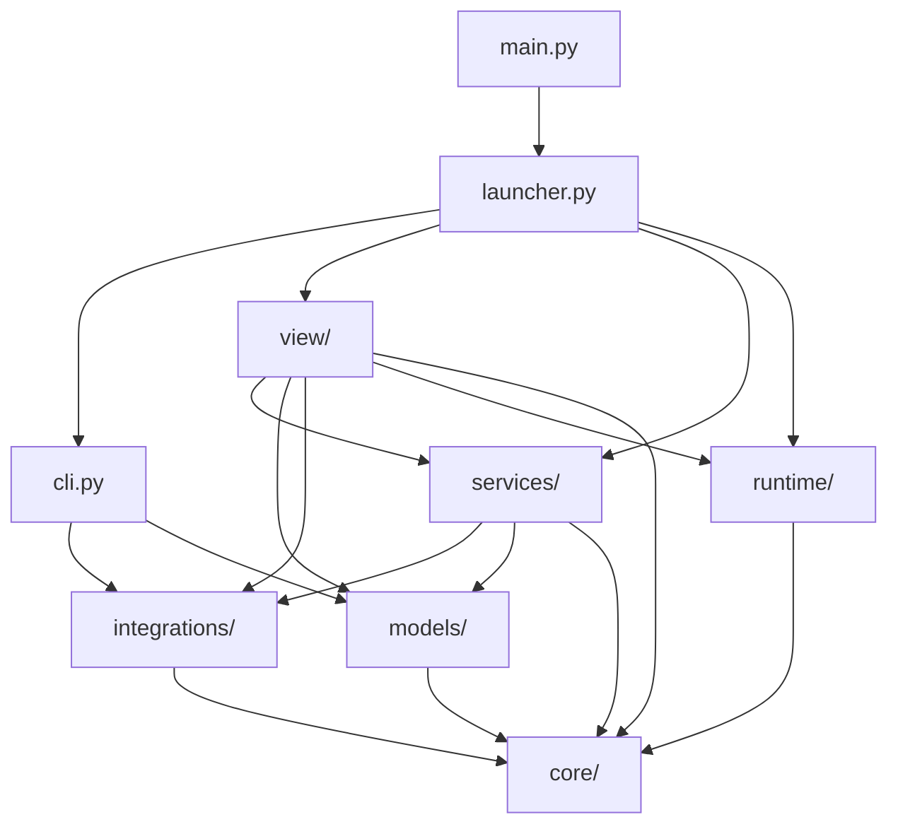
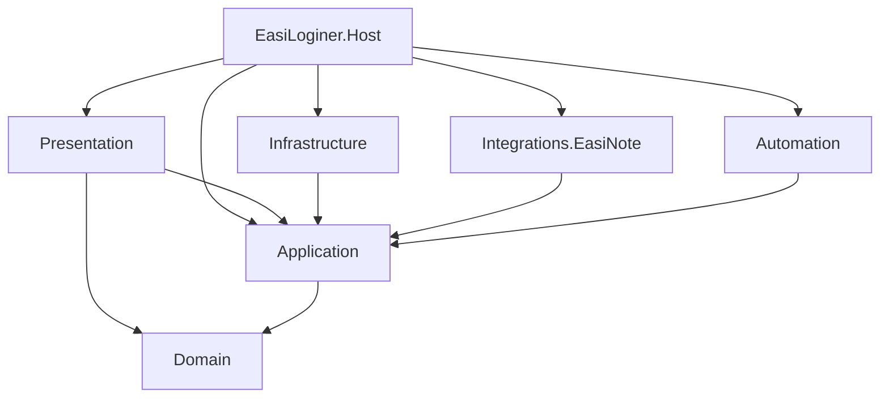
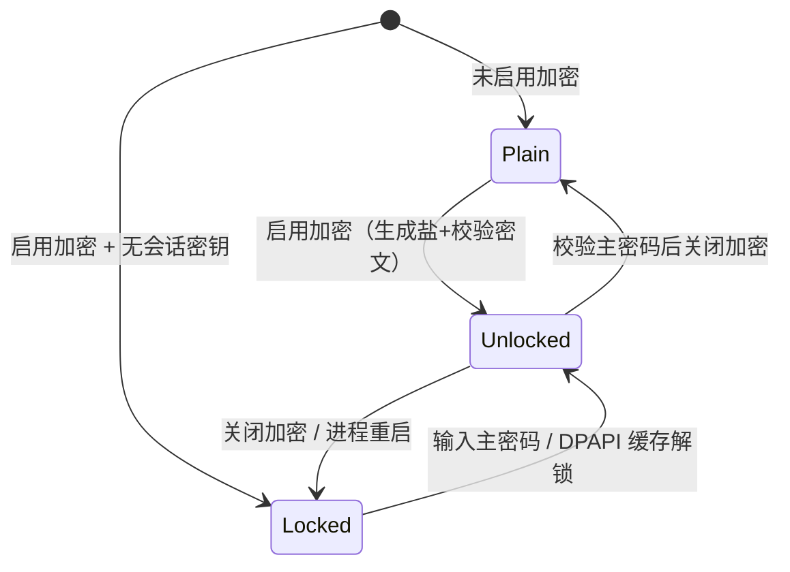
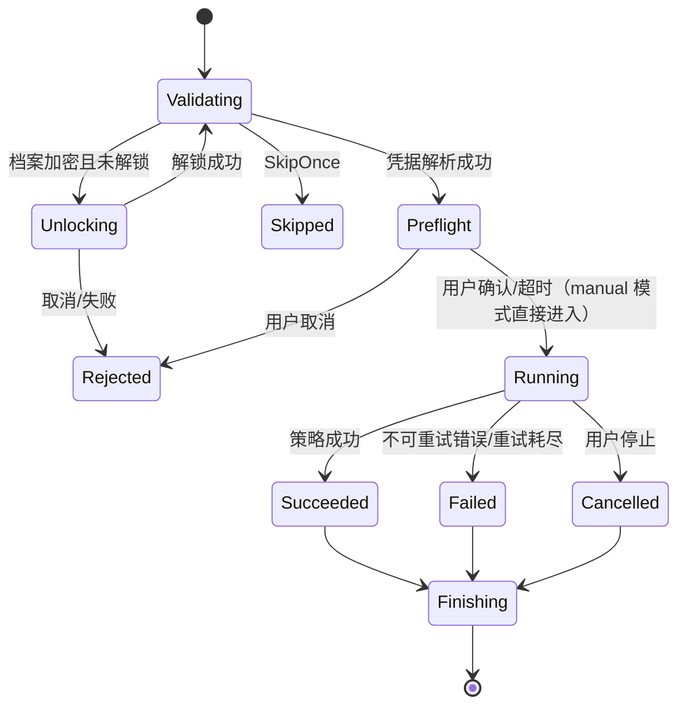
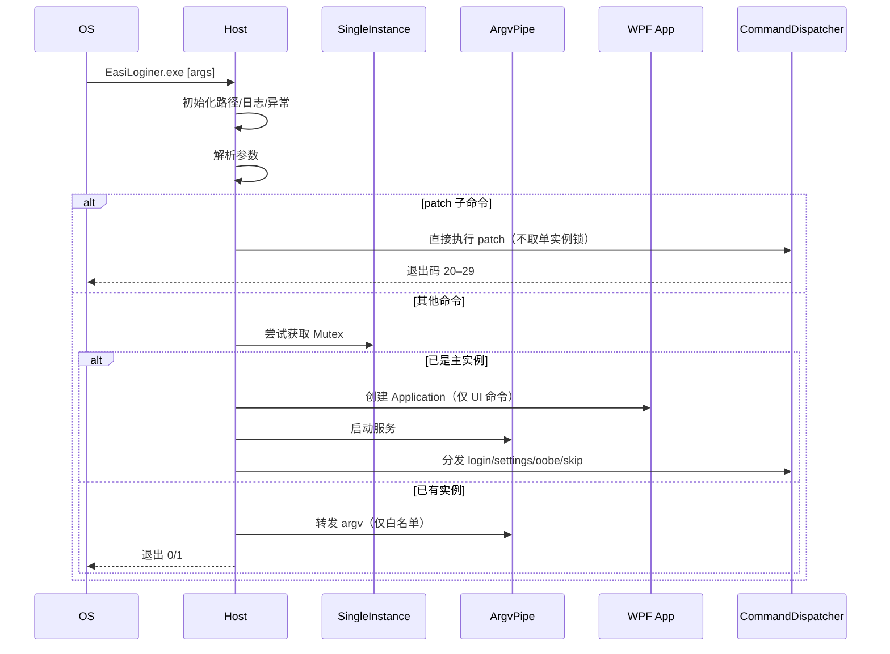

# EasiLoginer C# 重构框架

> 分析对象：`EasiAuto-master`（上游 EasiAuto v1.2.2b6，96 个 Python 源文件，含包 `__init__`；本次 C# 范围约 89 个，移除 7 个 ClassIsland 相关文件）
> 文档性质：**架构设计稿**，只给出框架、契约、迁移与实施路线，不产出可运行代码。
> 目标读者：负责 C# 重写的开发者 / 评审者。
>
> **项目更名（2026-10-24）**：新项目名为 **EasiLoginer**，作者 **SurinChi**；上游为 **EasiAuto**（作者 hxabcd，GPLv3）。下文中的 `EasiAuto` 仅指上游 Python 参考实现，`EasiLoginer` 指新 C# 项目。
>
> **范围变更（2026-10-20）**：本次开发**不支持 ClassIsland**。原文档中的 ClassIsland 集成、科目绑定、外部自动触发及相关页面/模型/测试全部移除；登录仅由用户在应用内、命令行或快捷方式**手动触发**。

---

## 0. 项目身份、开源声明与结论摘要

### 0.1 项目身份

| 项 | 值 |
|---|---|
| 项目名 | **EasiLoginer** |
| 作者 / 维护者 | **SurinChi** |
| 上游项目 | **EasiAuto**（https://github.com/hxabcd/EasiAuto），作者 hxabcd |
| 许可证 | **GNU General Public License v3.0**（衍生作品，必须继续 GPLv3） |
| 首版版本 | `2.0.0`（建议；与上游 EasiAuto 1.2.x 区隔） |
| 代码仓库 / 官网 | 待定（见 §17 第 14 项） |
| 可执行文件 | `EasiLoginer.exe` |
| 命名空间 / 程序集前缀 | `EasiLoginer.*` |
| 单实例 Mutex | `EasiLoginerMutex` |
| argv IPC 管道 | `EasiLoginer_Argv_IPC_v1` |
| 数据目录 | `data/`（`config.json` / `profile.json` 格式保持不变） |
| 遥测 | 不复用上游 Sentry DSN；未配置自己的 DSN 时默认关闭 |
| 更新 | 仅使用 EasiLoginer 自己的清单/资产，不读取 EasiAuto 更新通道 |

### 0.2 开源声明与合规

- **许可证**：项目继续以 **GPLv3** 发布，完整保留上游 `LICENSE` 文本与版权声明；新增 `Copyright (C) 2026 SurinChi`。
- **上游归属**：在 `README`、关于页、`NOTICE`/`THIRD-PARTY-NOTICES.md` 中注明：`EasiLoginer is based on EasiAuto by hxabcd (https://github.com/hxabcd/EasiAuto), licensed under GPLv3.`
- **不删除上游声明**：移植文件如保留上游代码/结构，需保留原版权头，并在文件头补充 EasiLoginer 的修改说明。
- **品牌区分**：不把 EasiAuto 的名称、图标、发布渠道当作 EasiLoginer 自有品牌；EasiAuto 仅作为“上游来源”出现。
- **源码可得**：分发二进制时同时提供对应源码的获取方式（GPLv3 要求）；修改版继续 GPLv3，不附加额外限制。
- **第三方 notices**：WPF-UI/Avalonia、FlaUI、OpenCvSharp、Serilog、Sentry、Konscious 等依赖的许可证单独汇总，随安装包分发。
- **隐私**：默认不向任何第三方发送遥测；启用 Sentry 必须使用 SurinChi 自己的 DSN，并在首次启动/设置页明确告知。

`NOTICE` 建议内容（随包分发）：

```text
EasiLoginer
Copyright (C) 2026 SurinChi

This program is based on EasiAuto (https://github.com/hxabcd/EasiAuto),
Copyright (C) hxabcd, licensed under the GNU General Public License v3.0.

EasiLoginer is free software: you can redistribute it and/or modify
it under the terms of the GNU General Public License as published by
the Free Software Foundation, either version 3 of the License, or
(at your option) any later version.

EasiLoginer is distributed in the hope that it will be useful,
but WITHOUT ANY WARRANTY; without even the implied warranty of
MERCHANTABILITY or FITNESS FOR A PARTICULAR PURPOSE.  See the
GNU General Public License for more details.

You should have received a copy of the GNU General Public License
along with this program.  If not, see <https://www.gnu.org/licenses/>.
```


### 0.3 结论摘要

- **运行时**：.NET 10（LTS）+ C# 14；Windows 10 1809+ / Windows 11。
- **UI**：WPF + WPF-UI（本文示例）或 Avalonia 12（备选，见 §3.2）；两者都只影响 Presentation。
- **形态**：`EasiLoginer.exe` 名称、便携目录、`data/` 与 `resources/` 布局、`config.json` / `profile.json` 格式全部保持不变。
- **分层**：Domain → Application → Infrastructure / Integrations / Automation → Presentation → Host，共 8 个项目；用项目引用 + 架构测试强制分层（替代 `check_layers.py`）。
- **登录自动化**：`登录管线 + 四种策略`（固定位置 / 图像识别 / UI Automation / 令牌投递），用 `Task + CancellationToken + IProgress<T>` 取代 `QThread + Signal`；**仅手动触发**。
- **触发方式**：应用内档案页“运行”、命令行 `login`、桌面/开始菜单快捷方式；不读取 ClassIsland 配置，不响应外部调度，不存在后台定时登录。
- **兼容优先**：Fernet 密文、Argon2id 参数、DPAPI 缓存、命名管道协议逐项对齐；先“取证”再编码。
- **最大风险**：上游 EasiAuto 更新器可能覆盖 EasiLoginer（两者资产/清单不互通），必须在发版与安装目录上彻底分开。
- **工作量**：约 20–22 人周；按 M0–M8 推进，先做非 UI 的可测试内核，再做 UI。

---

## 1. 现状解读

### 1.1 产品与运行形态

上游 EasiAuto 不是普通的“带界面的工具”，而是“**由用户手动触发的登录执行器** + **设置器**”；EasiLoginer 继承这一产品形态：

| 运行方式 | 命令 | 是否显示主界面 | 说明 |
|---|---|---|---|
| 主界面 | 无参数 / `settings` | 是 | 配置、档案、更新、关于 |
| 手动登录 | `login -i <id>` / `login -a <账号> -p <密码>` | 否 | 由用户/快捷方式手动调用；只显示横幅、状态浮窗、遮罩、确认弹窗 |
| 跳过一次 | `skip` | 否 | 写配置后退出 |
| 首次向导 | `oobe` | 是 | 7 步向导 |
| 修补白板 | `patch --on/--off` | 否 | 绕过单实例，可提权运行 |

关键特性：

- **登录只由用户手动触发**：应用内档案页“运行”、命令行 `login`、桌面/开始菜单快捷方式；没有 ClassIsland、没有后台定时器、没有外部自动调度。
- 单实例互斥 + 次实例把 argv 通过本地 IPC 转发给主实例；`patch` 例外。
- 便携式：所有可变数据在 exe 同级 `data/`，不写 `%APPDATA%`（除读取希沃自身的 `Configs.fkv`）。
- 无依赖注入容器：`config`、`profile`、`automation_manager` 等模块级单例 + 全局副作用。
- UI 文案、日志、注释全部为简体中文。

### 1.2 现有分层



`AGENTS.md` 声明的约束是：`core/`（无业务、无 UI）→ `models/` → `runtime/` / `integrations/` → `services/` → `view/`，组合根可依赖任意层。实际代码有几处**值得在 C# 中修正的债务**：

| 现状 | 问题 | C# 重构对策 |
|---|---|---|
| `models/config.py` 引入 `QColor`、`qt_pydantic`、`FieldInfo` | 领域模型被 UI 工具包与序列化框架污染 | 配置 POCO 保持纯净，颜色用自有值对象，元数据放独立目录 |
| `models/profile.py` 继承/持有 `QObject`、`Signal` | 领域实体承担通知职责 | 实体纯化，变更通知由 `ProfileService` 事件承担 |
| `core/display.py` 依赖 `QApplication` | “core 无 UI 依赖”名不副实 | 拆成 `Domain` 的纯几何计算 + `Infrastructure` 的屏幕度量 |
| `core/process.py` 承载快捷方式探测（COM） | 基础设施职责混杂 | 拆为 `ProcessManager` 与 `ShellLinkService` |
| `config_page.py` 用字符串路径建立从属关系、`SettingCard.index` 全局弱引用表 | 隐式约定，重构易断 | 显式 `ConfigCatalog` + 强类型依赖规则 |
| 大量 `time.sleep` / 全局单例 / `sys.exit` | 难以测试与取消 | `Task.Delay(token)`、构造注入、显式生命周期 |
| Qt 动画/滚动 FPS 补丁（`runtime/compatibility_patches.py`） | 依赖第三方库内部实现 | 不再需要；WPF 自带合成时钟，按刷新率渲染 |

### 1.3 关键机制清单

| 机制 | 入口 | 复刻要求 |
|---|---|---|
| 配置自动保存 + 元数据生成设置卡片 | `models/config.py` | 字段名、默认值、范围、枚举值、隐藏项、页面归属完全兼容 |
| 档案加密（Argon2id → Fernet）+ DPAPI 缓存 | `models/profile.py`、`core/security.py` | 密文可互通，schema 1/2 → 3 迁移 |
| 单实例 + argv IPC | `runtime/ipc.py`、`launcher.py` | Mutex 名、管道名、JSON 帧、转发白名单 |
| 登录四策略 + 重试 + 取消 + 进度 | `services/automation/` | 流程顺序、等待时长、重试语义、失败文案 |
| IWB 环境判定 | `integrations/easinote/env.py` | `Configs.fkv` 解析 + HID 枚举 + 启动参数优先级 |
| DLL 修补 + UAC 子进程 | `integrations/easinote/patcher.py`、`runtime/elevation.py` | 目标目录、标记字节、退出码 20–29 |
| 希沃 HTTP 登录 | `integrations/easinote/api.py` | 端点、Cookie、MD5、错误码 |
| 希沃命名管道 | `integrations/easinote/pipe.py` | 两条管道、单行 JSON、错误分类 |
| 手动触发入口 | `view/pages/profile_page.py`、`cli.py`、`view/shortcuts.py` | 应用内运行按钮、命令行、快捷方式；不读取任何外部调度配置 |
| 更新清单 / 镜像 / 延迟 / zip+批处理 | `services/update_service.py` | 清单字段、PEP 440 比较、镜像替换、安装脚本 |
| 公告拉取 / 过滤 | `services/announcement_service.py` | 时间窗、版本范围、severity、隐藏 ID |
| 覆盖层（横幅/浮窗/遮罩/确认） | `view/components/`、`view/login_preflight.py` | 置顶、点击穿透、不抢焦点、位置与尺寸 |
| 快捷键 / Toast / Sentry / 崩溃对话框 | `view/shortcuts.py`、`view/notifications.py`、`runtime/exception_handler.py` | 行为与文案对齐 |

### 1.4 规模与移植权重（按模块数估算）

| 层 | 模块数（约） | 移植难度 | 说明 |
|---|---:|---|---|
| Domain（配置/档案模型） | 3 | 中 | 结构清晰，但加密与迁移细节多 |
| Application（服务/用例） | 5 | 中 | 登录管线是核心 |
| Integrations（仅希沃） | 7 | 高 | Win32、管道、注册表、HID、二进制补丁 |
| Automation（四策略） | 8 | 高 | 依赖输入模拟、UIA、图像匹配 |
| Runtime（IPC/提权/异常） | 7 | 中 | 一部分直接删除（Qt 补丁） |
| View（页面/组件/向导） | 32 | 高（量大） | 观感与交互细节多；仅 4 页 |
| Tools（构建/发版） | 14 | 低 | 发版工具可暂留 Python |

> 按目录粗分，未计各包的 `__init__` 与组合根；目标 C# 范围约 89 个 Python 源文件（移除 ClassIsland 相关 7 个）。

> UI 代码占全项目一半以上，且细节密集。**不要先写 UI**：先把数据、加密、IPC、集成与自动化做成可测试内核，再用 UI 包壳。

---

## 2. 目标与约束

### 2.1 必须行为等价（P0）

1. CLI 参数、退出码、`patch` 绕过单实例、转发白名单、互斥锁/管道名。
2. `login` 的五道前置：运行中拒绝 → 档案解锁 → `SkipOnce` → 凭据解析 → 运行前确认。
3. 四种登录方式的步骤顺序、坐标/模板、等待时长、失败是否可重试。
4. 登录成功/失败/中断后的收尾：遮罩回收、失败 Toast、更新检查、退出策略。
5. 统计计数（总数/成功/中断/按账号脱敏）与运行时长。
6. `config.json`、`profile.json` 的读写兼容（旧 `ClassIsland` 段读取时忽略并丢弃）。
7. 单实例转发与“由 IPC 触发时不退出”的语义。
8. 更新：清单获取、PEP 440 比较、镜像选择、下载校验、批处理安装、开发环境保护。
9. 公告：拉取失败静默、最多显示 3 条、忽略后持久化。
10. OOBE 7 步、完成后的页面直达、快捷方式创建。
11. 登录只能手动触发：应用内运行、命令行、快捷方式；不存在后台定时、外部调度或自动触发入口。

### 2.2 非功能目标

| 指标 | 目标 |
|---|---|
| 冷启动（SSD，含首帧） | ≤ 2.0 s（不含 Splash 人为延时） |
| 登录附加开销 | 与 Python 版相差 ≤ 10%（同机同网络） |
| 空闲内存 | ≤ 250 MB |
| UI 卡顿 | 主线程单次阻塞 ≤ 100 ms |
| 崩溃可诊断性 | 100% 未处理异常落日志 + Sentry（若开启） |
| 安全 | 日志/遥测不出现明文账号密码；密钥不落盘（仅 DPAPI 密文） |
| 可维护性 | 领域/应用层不引用 WPF/Win32；分层测试通过 |

### 2.3 硬约束

- **Windows only**；最低 Windows 10 1809（`net10.0-windows10.0.19041.0` 的 API 约定需在实施时确认，Mica 仅 Win11）。
- **GPLv3**：本重写属于衍生作品，必须继续以 GPLv3 发布；保留上游 EasiAuto 的 `LICENSE`/版权/来源声明与第三方 notices，并新增 SurinChi 的版权声明。
- **中文优先**：UI、日志、注释使用简体中文；为将来本地化预留 `RESX`，但默认 `zh-Hans`。
- **便携目录**：`AppContext.BaseDirectory` 下的 `data/`、`resources/`；不依赖安装器写注册表。
- **无管理员常驻**：仅 `patch` 通过 UAC 子进程提权。
- **不集成 ClassIsland**：不读取/写入其 `Settings.json`、`Profiles`、`Automations`，不探测其进程/Mutex，不创建/修改其自动化项，不提供科目绑定。
- **只手动触发**：不实现定时器、计划任务、文件监视、进程启动即登录等自动触发路径。
- **数据可回滚**：测试期内 Python 版仍应能读取 C# 版写出的数据（保持字段与格式，不新增未知必填字段）。

### 2.4 明确不做（首版）

- **ClassIsland 集成**：配置文件读写、科目/档案绑定、自动化生成、进程启停与状态检测、旧自动化导入，全部不做。
- **任何自动触发**：后台调度、定时任务、开机自启后自动登录、外部程序拉起即登录，全部不做；登录只由用户手动发起。
- 跨平台（Avalonia/MAUI 不在范围内）。
- 跨架构（仅 `win-x64`；`win-arm64` 后续评估）。
- 重写 `DllPatcher` 的 IL 补丁逻辑：直接复用仓库中现有的 C# 项目。
- 重写发行中心（`tools/distribution_center`）：发版流程可继续用 Python，后续再独立迁移。
- 录制坐标模式（Python 侧仍是 TODO，C# 首版不做）。
- 新增登录方式、二维码登录（当前代码中没有）。

### 2.5 代码层禁止项（评审时直接搜索/架构测试）

以下内容在 C# 解决方案中**不得出现**：

- 项目/命名空间/类型：`EasiLoginer.Integrations.ClassIsland`、`ClassIslandStore`、`ClassIslandBindingBackend`、`IBindingBackend`、`SubjectRef`、`ManagedCiAutomation`、`CiSubject`。
- 配置：`ClassIsland` 段、`DefaultDisplayName`、`DefaultPreTime`、`Internal.IsAutomationPageNoticeShown`。
- 页面/VM：`AutomationPage`、`BindingPage`、`ClassIslandStatusPoller`。
- 行为：读取/写 `Settings.json`/`Profiles`/`Automations`、打开 `Global\ClassIsland.Lock`、解析 `ClassIsland.lnk`、生成 `classisland.os.run` 动作。
- 触发：定时器、计划任务、文件/进程监视、开机自启后登录、任何第三方回调式登录。

> 说明：本文档保留少量“已移除/禁止”的说明性文字用于评审与迁移；C# 代码中不得出现上述类型、配置键或行为。Python 参考项目仍保留这些代码作为取证/对照，不在本次 C# 改动范围内。

---

## 3. 技术选型

### 3.1 总表

| 领域 | 选择 | 备选 | 理由 |
|---|---|---|---|
| 运行时 | **.NET 10 LTS** | .NET 9 | 长期支持；WPF 与 WinRT 投影成熟 |
| UI | **WPF + WPF-UI（4.x 或实施时最新稳定版）** | WinUI 3 / Avalonia | Fluent 控件齐、覆盖层/点击穿透/置顶容易、无打包依赖、单文件发布简单 |
| MVVM | **CommunityToolkit.Mvvm** | Prism / ReactiveUI | 轻量、源生成器、无框架侵入 |
| 宿主/DI | **Microsoft.Extensions.Hosting + DI** | 手写组合根 | 配置、日志、HttpClientFactory、生命周期开箱即用 |
| JSON | **System.Text.Json + Source Generator** | Newtonsoft.Json | 内置、AOT 友好；仅在需要保留未知字段处用 `JsonNode` |
| 日志 | **Serilog**（Console + File + Sentry） | Microsoft.Extensions.Logging 内置 | 结构化、异步落盘、与 Sentry 集成 |
| 遥测 | **Sentry .NET（可选）** | 自建 | 使用 SurinChi 自己的 DSN；未配置则关闭，不复用上游 |
| HTTP | **IHttpClientFactory + HttpClient** | RestSharp | 超时/重试/代理策略可控 |
| CLI | **System.CommandLine** | Spectre.Console.Cli | 子命令、互斥参数、帮助文本 |
| UI Automation | **FlaUI.UIA3** | 内置 `System.Windows.Automation` | 更稳的 UIA3 封装、查找语法贴近 pywinauto |
| 图像匹配 | **OpenCvSharp4** | Emgu CV / 手写像素扫描 | 模板匹配成熟；模板仅 3×变体 |
| P/Invoke | **Microsoft.Windows.CsWin32** | 手写 DllImport | 源生成强类型 API，减少签名错误 |
| 加密 | **Konscious.Security.Cryptography.Argon2** + **ProtectedData** + 自实现 Fernet | BouncyCastle | 参数/格式可与 Python 完全对齐 |
| 通知 | **Windows.UI.Notifications（CsWinRT）** | CommunityToolkit Notifications | 与现实现同为 WinRT Toast |
| 打包 | **dotnet publish 自包含 + ZIP** | Velopack / MSIX | 维持“解压即用”；更新器沿用批次脚本 |
| 测试 | **xUnit + FluentAssertions + Verify + NSubstitute + NetArchTest** | MSTest | 快照测 JSON、架构测分层 |

> 版本号在实施时锁定到当时的最新稳定版，并在 `Directory.Packages.props` 统一管理；不要把本文的包名当成版本承诺。
>
> UI 框架尚未最终锁定：本文以 WPF + WPF-UI 为实现示例；若选 Avalonia 12，仅 Presentation 与 Host 组合根需替换，§10 的组件映射需按 Avalonia 重写，其余章节不变。

### 3.2 UI 框架决策（ADR-001）

| 维度 | WPF + WPF-UI（推荐） | WinUI 3 | Avalonia |
|---|---|---|---|
| Fluent 观感 | 高（WPF-UI 提供 Fluent 2 控件/图标/Mica） | 最高（原生） | 中（主题可定制） |
| 无边框/点击穿透/置顶工具窗 | 容易（`WS_EX_*` + `AllowsTransparency`） | 较难，需 AppWindow/互操作 | 中 |
| 未打包运行 | 原生支持 | 需 Windows App Runtime 引导 | 原生 |
| Toast/通知 | WinRT 投影可用 | 原生 | 需互操作 |
| 单文件发布 | 成熟 | 较复杂 | 成熟 |
| 动画帧率 | 合成线程，够用 | 最好 | 好 |
| 风险 | 观感需手工调 | 部署/生命周期复杂 | 需自绘 Fluent 卡片 |

结论：本项目 **Windows-only + 大量 Win32 + 需要覆盖层**，WPF 的综合风险最低。若团队强偏好原生 Fluent，可在 M0 用 WinUI 3 做一个“覆盖层 + 单实例 + Toast”的 spike 再定案；若团队已有 Avalonia 经验，Avalonia 12 同样可行，但需先验证覆盖层点击穿透与系统 Toast。

### 3.3 Python 依赖 → .NET 对照

| Python | 用途 | .NET |
|---|---|---|
| PySide6 / qfluentwidgets | UI | WPF + WPF-UI |
| pydantic / qt-pydantic | 模型校验、序列化、元数据 | POCO + `System.Text.Json` + `DataAnnotations`/自定义元数据 |
| cryptography（Fernet/Argon2id） | 档案加密 | `Konscious...Argon2` + 自实现 Fernet（AES-128-CBC + HMAC-SHA256） |
| pywin32 | 注册表/窗口/COM/DPAPI | CsWin32 + `Microsoft.Win32` + `ProtectedData` + COM 互操作 |
| pywinauto | UIA | FlaUI.UIA3 |
| pyautogui / pyperclip | 输入模拟/剪贴板 | 自写 `SendInput` 封装 + Win32 剪贴板 |
| Pillow / OpenCV | 模板匹配 | OpenCvSharp4 + `Graphics.CopyFromScreen` |
| psutil | 进程枚举/终止 | `System.Diagnostics.Process` |
| requests | HTTP | `HttpClient` + `IHttpClientFactory` |
| loguru | 日志 | Serilog |
| sentry-sdk | 遥测 | Sentry .NET |
| windows11toast | Toast | WinRT `ToastNotificationManager` |
| packaging.version | PEP 440 | 自实现 `Pep440Version`（见 §5.4） |
| lief | 依赖清单中声明但代码未使用 | 无需；补丁由 `EasiLoginer.Patcher` 完成 |
| shiboken6 | Qt 对象有效性 | 不需要（托管对象生命周期由 DI/作用域管理） |

---

## 4. 解决方案结构

### 4.1 项目清单

| 项目 | TFM | 职责 | 允许引用 |
|---|---|---|---|
| `EasiLoginer.Domain` | `net10.0` | 配置/档案实体、值对象、枚举、纯策略（坐标、版本、重试、更新决策） | 无（仅 BCL） |
| `EasiLoginer.Application` | `net10.0` | 用例编排、端口定义、登录管线、状态机、事件 | Domain |
| `EasiLoginer.Infrastructure` | `net10.0-windows` | 文件、JSON、加密、DPAPI、IPC、日志、HTTP、更新、快捷方式、提权、屏幕/进程/窗口度量 | Application, Domain |
| `EasiLoginer.Integrations.EasiNote` | `net10.0-windows` | 希沃路径/环境/进程/窗口/API/管道/补丁 | Application, Domain |
| `EasiLoginer.Automation` | `net10.0-windows` | 四种登录策略、输入模拟、UIA 元素、模板匹配 | Application, Domain |
| `EasiLoginer.Presentation` | `net10.0-windows` | WPF 壳、页面、VM、控件、覆盖层、OOBE、主题 | Application, Domain, WPF-UI |
| `EasiLoginer.Host` | `net10.0-windows` | `Program`、组合根、CLI、单实例、生命周期、全局异常 | 全部 |
| `EasiLoginer.Patcher` | `net10.0` | 收编现有 `tools/DllPatcher`，独立进程运行 | 无 |

> Windows 项目建议统一为 `net10.0-windows10.0.19041.0`（以使用 WinRT/Toast 投影），最低运行版本由 `SupportedOSPlatformVersion` 控制（如 `10.0.17763.0`），不要用 TFM 代替运行时检查。

测试项目：

```
tests/
  EasiLoginer.Domain.Tests/            # 坐标、版本、重试、更新决策
  EasiLoginer.Application.Tests/       # 登录管线（假策略）、凭据解析、手动触发用例
  EasiLoginer.Infrastructure.Tests/    # JSON/Fernet/DPAPI/IPC/安装脚本
  EasiLoginer.IntegrationTests/        # 本地 HTTP、假管道、临时目录补丁
  EasiLoginer.Architecture.Tests/      # NetArchTest 分层规则
  EasiLoginer.UiTests/                 # FlaUI 冒烟（可选）
```

### 4.2 目录树

```
EasiLoginer/
├─ EasiLoginer.sln
├─ Directory.Build.props            # Nullable、LangVersion、TreatWarningsAsErrors、中文资源
├─ Directory.Packages.props         # 集中包版本
├─ global.json                      # 锁定 SDK
├─ .editorconfig
├─ LICENSE                          # GPLv3 全文（保留上游版权声明，新增 SurinChi）
├─ NOTICE                           # 上游 EasiAuto 归属与修改说明
├─ THIRD-PARTY-NOTICES.md           # 依赖许可证汇总
├─ README.md                        # 项目说明、上游归属、构建/迁移
├─ build/
│  ├─ publish.ps1                   # 发布 + 资源复制 + ZIP
│  ├─ app.manifest                  # asInvoker、PerMonitorV2、longPathAware
│  └─ installer/                    # 可选：Inno Setup / MSIX
├─ resources/                       # EasiLoginer 品牌资源 + EasiNoteUI 模板；不复制上游 banner/author_avatar
├─ src/
│  ├─ EasiLoginer.Domain/
│  │  ├─ Configuration/             # Config、LoginConfig、...、枚举
│  │  ├─ Profiles/                  # Profile、AutomationProfile、ProfileSchema
│  │  ├─ Automation/                # LoginStatus、LoginOutcome、异常
│  │  ├─ Geometry/                  # PixelPoint、ScreenMetrics、LoginWindowGeometry
│  │  ├─ Versioning/                # Pep440Version
│  │  └─ Statistics/
│  ├─ EasiLoginer.Application/
│  │  ├─ Abstractions/              # 端口（见 §6.1）
│  │  ├─ Configuration/
│  │  ├─ Profiles/
│  │  ├─ Login/                     # LoginCoordinator、LoginRequest、阶段
│  │  ├─ Automation/                # AutomationCoordinator、LoginPipeline、LoginContext
│  │  ├─ Announcements/
│  │  └─ Updates/
│  ├─ EasiLoginer.Infrastructure/
│  │  ├─ Paths/
│  │  ├─ Configuration/
│  │  ├─ Profiles/
│  │  ├─ Security/
│  │  ├─ Ipc/
│  │  ├─ Http/
│  │  ├─ Updates/
│  │  ├─ Notifications/
│  │  ├─ Shortcuts/
│  │  ├─ Windows/                   # Process、Window、Display、Elevation、Hid
│  │  ├─ Telemetry/
│  │  └─ Diagnostics/
│  ├─ EasiLoginer.Integrations.EasiNote/
│  │  ├─ Auth/                      # SeewoAuthClient、模型、异常
│  │  ├─ Environment/               # Fkv、Hid、Iwb 判定
│  │  ├─ Pipe/
│  │  ├─ Patching/
│  │  └─ Process/
│  ├─ EasiLoginer.Automation/
│  │  ├─ Strategies/
│  │  ├─ Input/
│  │  ├─ Recognition/
│  │  └─ Uia/
│  ├─ EasiLoginer.Presentation/
│  │  ├─ Shell/                     # MainWindow、NavigationService、Splash
│  │  ├─ Pages/                     # Config/Profile/Update/About（4 页）
│  │  ├─ ViewModels/
│  │  ├─ Settings/                  # ConfigCatalog、SettingsCardFactory
│  │  ├─ Login/                     # LoginPreflightCoordinator
│  │  ├─ Controls/                  # SettingsCard、ProfileCard、Tag、AnnouncementCard...
│  │  ├─ Overlays/                  # Banner、StatusOverlay、PrivacyMask、PreRunDialog
│  │  ├─ Dialogs/                   # CrashDialog、MasterPasswordDialog、AdvancedOptions
│  │  ├─ Onboarding/                # WizardWindow + 7 steps
│  │  ├─ Theming/                   # Tokens.xaml、颜色/圆角/字体
│  │  └─ Common/
│  ├─ EasiLoginer.Host/
│  │  ├─ Program.cs
│  │  ├─ CommandLine/
│  │  ├─ SingleInstance/
│  │  ├─ Lifecycle/
│  │  └─ Diagnostics/               # 全局异常、崩溃对话框
│  └─ EasiLoginer.Patcher/
└─ tests/
```

### 4.3 依赖规则（强制）



规则：

1. `Domain` 不引用任何其他项目；禁止 `System.Windows`、`Microsoft.Win32`、`HttpClient`、`Microsoft.Extensions.*`（`TimeProvider` 可用 BCL）。
2. `Application` 只引用 `Domain`；禁止 WPF、Win32、具体 HTTP/文件实现。
3. `Infrastructure` / `Integrations.EasiNote` / `Automation` 实现 `Application` 的端口，**彼此不互相引用**。
4. `Presentation` 只引用 `Application` + `Domain`，**不直接引用** `Infrastructure`/`Integrations`（通过端口调用）。
5. `Host` 是唯一组合根；允许引用全部。
6. `EasiLoginer.Patcher` 独立、无业务依赖，可由 `Host` 以子进程方式调用。

强制手段：

- 项目文件只写允许的 `<ProjectReference>`；
- `EasiLoginer.Architecture.Tests` 用 NetArchTest 断言“Domain 不依赖 System.Windows”“Presentation 不依赖 Infrastructure”等；
- 流水线上 `dotnet build` + 架构测试作为合并门禁；
- 替代 Python 的 `tools/develop/check_layers.py`。

### 4.4 命名与代码约定

- 类型/成员：PascalCase；异步方法 `Async` 后缀；接口 `I` 前缀。
- 后缀语义：`Service`（有状态能力）、`Coordinator`（编排）、`Strategy`（可替换算法）、`Store`（持久化）、`Adapter`（外部系统）、`Factory`（创建）、`ViewModel`（呈现）。
- JSON DTO 用 `[JsonPropertyName]` 显式固定字段名，**不依赖命名策略**（避免全局 camelCase 破坏兼容）。
- 可空引用类型开启；`TreatWarningsAsErrors`；分析器 `CA`/`IDE` 按需启用。
- 业务异常：`LoginException`（含 `CanRetry`）、`LoginCancelledException`、`ProfileLockedException`、`UpdateException`、`PipeUnavailableException` / `PipeDeniedException`；不要用异常做流程分支的常规手段。
- 日志模板使用 `{Placeholder}` 结构化写法；中文消息；账号脱敏。
- UI 字符串统一进 `Strings.zh-Hans.resx`（首版可直接写 XAML，但需留出资源化路径）。

---

## 5. 领域层设计

### 5.1 配置模型

保持上游 EasiAuto 的 `config.json` 结构，但**移除 `ClassIsland` 配置段**。建议用嵌套 POCO，字段名与现文件一致：

| 分组 | 关键字段（类型/默认值） |
|---|---|
| `Login` | `Method`（枚举 0–3，默认 0=固定位置）、`SkipOnce`（false）、`SkipIfLoggedIn`（true）、`KillAgent`（false）、`ForceCompatibilityMode`（false，**旧键名 `ForceEnableScaling` 需兼容读取**） |
| `Login.EasiNote` | `AutoPath`（true）、`Path`（`C:\Program Files (x86)\Seewo\EasiNote5\swenlauncher\swenlauncher.exe`）、`ProcessName`（`EasiNote`）、`WindowTitle`（`希沃白板`）、`Args`（`""`）、`ExtraKills`（`""`） |
| `Login.Timeout` | `Terminate`=1、`LaunchPollingTimeout`=30、`LaunchPollingInterval`=0.5、`AfterLaunch`=2、`EnterLoginUI`=3、`SwitchTab`=1（秒，范围 0–60 / 0.1–60） |
| `Login.Position` | `EnableScaling`=true、`EnterLogin`=(172,1044)、`AccountLoginTab`=(1090,350)、`AccountInput`=(1000,420)、`PasswordInput`=(1000,490)、`AgreementCheckbox`=(935,724)、`LoginButton`=(1090,560)、`BaseSize`=(1920,1080)（隐藏）、`LoginWindowSize`=(808,582)（隐藏） |
| `Warning` | `Enabled`=true、`Timeout`=60、`MaxDelays`=1、`DelayTime`=150（**旧键名 `Delay`**）、`ShowUserName`=true |
| `Banner` | `Enabled`=true、`Style`：`Text`、`TextFont`=`HarmonyOS Sans SC`、`TextColor`=`#FFFFDE59`、`FgColor`=`#C8FFDE59`、`BgColor`=`#B4E4080A`、`Fps`=60、`TextSpeed`=3、`YOffset`=20 |
| `StatusOverlay` | `Enabled`=true |
| `App` | `MaxRetries`=2、`Theme`（`Auto`/`Light`/`Dark`）、`LogEnabled`=true、`TelemetryEnabled`=**false**（新装默认；仅配置 SurinChi 自己的 DSN 后生效） |
| `Experimental.PrivacyMask` | `Enabled`=true、`MaskLeftTop`=(868,381)、`MaskSize`=(440,386) |
| `Profile` | `SkipVerify`=false |
| `Update` | `Mode`=**0**（首发默认 NEVER；自有清单可用后再开启）、`CheckAfterLogin`=true、`TargetUpdateChannel`=`release`、`TargetDownloadSource`=`auto`、`LastVersion`=`Unknown`（隐藏） |
| `Debug` | `EasterEggEnabled`、`DebugMode`、`VerboseLog`、`AlternateFindWindowMethod`（均 false） |
| `Internal` | `IsOobeCompleted`、`IsProfilePageNoticeShown`、`LastUpdateCheckTime`（可空）、`HiddenAnnouncementIds`（字符串数组） |
| `Statistics` | `FirstRunDate`、`LoginCounts`、`LoginSuccessCounts`、`LoginInterruptCounts`、`TotalRunTime`、`TotalLoginTime`、`MaxLoginTime`、`LoginCountsPerAccount`（脱敏键 → 次数）；`LoginFailureCounts` 为计算属性；`ThisInstanceLaunchTime` 不落盘 |

注意：

- Python 的 `PAGE_INDEX` 决定“配置页显示哪些组”，C# 用 `ConfigCatalog` 显式登记（见 §10.4）；`AutomationPage` 条目与 `ClassIsland` 组一并删除。
- 旧 `config.json` 中可能存在 `ClassIsland` 段与 `Internal.IsAutomationPageNoticeShown`；读取时忽略，首次保存后自然丢弃（不回写）。
- **遥测默认关闭**：`TelemetryEnabled=false`；读取旧配置为 `true` 时，若未配置 SurinChi 自己的 Sentry DSN，运行时仍禁用并提示一次。
- **更新默认关闭**：`Update.Mode=0`；只有配置了 EasiLoginer 自己的 `update.json` 后才允许开启；旧配置的 `Mode=3` 不会直接生效。
- `App.LogLevel` 在配置页代码中被引用但模型里不存在（死代码），不要移植。
- 未知字段：Python pydantic 默认忽略；C# 也应忽略，保证向前/向后兼容。
- 序列化枚举：`LoginMethod`/`UpdateMode` 写整数；`ThemeOptions`/`UpdateChannel`/`DownloadSource` 写字符串值。
- 元组坐标写 `[x, y]` 数组；`QColor` 很可能是 `#AARRGGBB` 字符串（以 M0 抓取的真实文件为准）。
- 时间写 ISO 8601（带时区）；C# 默认 `DateTimeOffset` 的 `"O"` 输出 `+00:00`，与 Python 的 `Z` 不同，需自定义转换器保持文本一致或确认 Python 能容忍。

### 5.2 档案模型与状态机

```
Profile
 ├─ schema_version = 3
 ├─ encryption_enabled : bool
 ├─ encryption_salt : base64(16B) | null
 ├─ encryption_check : "ea$..."（主密码校验密文） | null
 ├─ passwordless_view : bool（默认 true）
 ├─ automations : EasiAutomation[]
 └─ notifier（Python 专属，C# 删除）
```

`EasiAutomation` 字段（上游类名；C# 侧改名 `AutomationProfile`，避免沿用上游品牌）：`name`、`enabled`、`id`（UUID 字符串）、`type="password"`、`account`、`password`、`account_name`、`avatar`（本地路径字符串，Python 类型为 Any，读取时需容错）、`login_uid`。

状态机：



关键行为（必须保留）：

- 未解锁且启用加密时**拒绝保存**（`ProfileLockedError`），避免把空密码写回磁盘。
- 启用加密：生成 16 字节盐 → Argon2id 派生 → 写校验密文 → 加密保存全部档案 → 派生密钥写入 DPAPI 缓存。
- 关闭加密：先校验主密码 → 重新载入明文（`reload`）→ 关闭标记 → 保存 → 清空会话密钥与缓存。
- 解锁：校验 `encryption_check` → 设会话密钥 → 缓存 → `reload`。
- `passwordless_view=false` 时，档案页本次启动需再输一次主密码（登录流程不受影响）。
- 保存时若账号/密码为空，Python 的 `model_serializer` 会抛错；C# 保存前同样校验，避免写出非法档案。
- `schema_version < 2` → 重建空档案（现有行为，虽激进但需保持）；`< 3` 或“旧机器密钥加密” → 归一化为明文，失败则备份 `profile.json.bak` 并把解不开的密码置空。

### 5.3 值对象与纯策略

| 对象 | 职责 | 备注 |
|---|---|---|
| `PixelPoint` | 整数屏幕坐标 | 对应 `core/display.py::Point` |
| `ScreenMetrics` | 物理尺寸、逻辑尺寸、缩放、刷新率 | 由 `IDisplayMetrics` 提供，Domain 只做计算 |
| `LoginWindowGeometry` | 登录窗坐标换算 | 纯函数，必须有表驱动单测 |
| `Pep440Version` | 解析/比较 `1.2.2b6`、`1.2.0rc1`、`postN` | 更新/公告依赖，不能用 `System.Version` 或 SemVer 代替 |
| `RetryPolicy` | 最大重试、可重试判定、退避 | 从 `LoginException.CanRetry` + `App.MaxRetries` 推导 |
| `UpdateDecision` / `ChangeLog` | 更新判定结果 | 由清单 + 当前版本 + 通道计算 |
| `LoginOutcome` | Success / Failed / Cancelled | 与统计、UI 状态一致 |

坐标换算必须逐字复刻：

```
windowPosition = (baseSize - loginWindowSize) / 2
relative       = position - windowPosition
scaledRelative = relative * scale
scaledTopLeft  = (physicalScreen - loginWindowSize * scale) / 2
result         = scaledRelative + scaledTopLeft
```

“进入登录界面”按钮是特例：`x = x * scale`，`y = screenHeight - (baseHeight - y) * scale`。

注意 `Point.scale` 在 Python 中是**类级全局缓存**（首次调用后固定），C# 不要复刻这个隐藏状态；应把 `scale` 作为显式参数传入，并用“每次登录开始时解析一次”的 `DisplaySnapshot` 保证一致性。

### 5.4 版本比较（PEP 440）

更新清单与公告都使用 Python `packaging.version.Version`，支持 `1.2.0.dev1`、`1.2.0a1`、`1.2.0b1`、`1.2.0rc1`、`1.2.0`、`1.2.0.post1`/`1.2.0r1`。C# 方案：

- 实现 `Pep440Version`（解析 + `IComparable`），覆盖项目实际使用的段类型；
- 或以清单中的版本顺序作为兜底（不推荐，容易错）；
- 禁止用 `NuGet.Versioning` 直接解析 `1.2.2b6`（不是合法 SemVer）。

单测用例至少包含：`1.2.2b6 < 1.2.2`、`1.2.0rc1 < 1.2.0`、`1.1.4r1 > 1.1.4`、`1.2.0.dev1 < 1.2.0a1`、非法字符串。

---

## 6. 应用层设计

### 6.1 端口清单

| 端口 | 职责 | 实现位置 |
|---|---|---|
| `IConfigService` / `IConfigStore` | 读写配置、路径寻址、重置、变更通知、延迟保存 | Application / Infrastructure |
| `IProfileService` / `IProfileRepository` | 档案 CRUD、加密状态、解锁、保存事件 | Application / Infrastructure |
| `IMasterKeyDeriver` / `IProfileCipher` / `IMasterKeyCache` | Argon2id、Fernet、DPAPI 缓存 | Infrastructure |
| `ICredentialResolver` | `id` 或 `account/password` → 凭据 | Application |
| `ILoginCoordinator` | 登录前置、UI 协作、退出策略 | Application |
| `IAutomationCoordinator` | 单飞、启动/停止、事件 | Application |
| `ILoginStrategy` | 四种登录方式 | Automation |
| `ILoginPipeline` | 准备 → 登录 → 收尾 → 重试 | Application |
| `IEasiNoteLocator` | 注册表/回退/手动路径 | Integrations.EasiNote |
| `IEasiNoteEnvironment` | fkv、HID、IWB 判定、启动参数 | Integrations.EasiNote |
| `IEasiNoteProcessController` | 终止/启动 | Integrations.EasiNote |
| `ISeewoAuthClient` | HTTP 登录、用户信息、头像 | Integrations.EasiNote |
| `ISeewoPipeClient` | 两条命名管道 | Integrations.EasiNote |
| `IEasiNotePatcher` | 状态检测、修补/撤销 | Integrations.EasiNote |
| `IWindowService` | 查找/枚举/前台化/日志 | Infrastructure |
| `IDisplayMetrics` | 物理/逻辑尺寸、缩放、刷新率 | Infrastructure |
| `IInputSimulator` | 点击、输入、按键、兼容模式 | Automation |
| `IScreenCapture` / `ITemplateMatcher` | 截图、模板匹配 | Automation |
| `IAnnouncementService` | 拉取/过滤 | Application |
| `IUpdateService` | 检查/下载/安装/取消 | Application |
| `ISingleInstanceService` / `IArgumentForwarder` | Mutex + 管道 | Infrastructure |
| `IShortcutService` / `IToastService` | 快捷方式 / 通知 | Infrastructure |
| `IThemeService` / `INavigationService` / `IDialogService` | 呈现层服务 | Presentation |
| `IExceptionReporter` / `IAppLifecycle` | 异常上报 / 退出重启 | Host |

原则：**只为“需要替换、需要 mock、跨层边界”定义接口**；不要给每个类都套接口。

### 6.2 登录编排状态机



阶段与职责：

| 阶段 | 行为 | 失败处理 |
|---|---|---|
| 单飞检查 | 已有任务则拒绝 | 记录警告，返回 false |
| 档案解锁 | 缓存静默解锁；否则弹主密码框 | 中止；非 IPC 时退出 1 |
| `SkipOnce` | 读取后清零并退出 | 非 IPC 时退出 0 |
| 凭据解析 | `id` → 档案（存在/启用/账号密码非空）；否则 `account+password` | 中止；非 IPC 时退出 1 |
| 运行前确认 | `Warning.Enabled` 且非 `manual`：倒计时/推迟/取消 | 取消则退出（IPC 时只返回） |
| 展示临时 UI | 横幅、状态浮窗（关联停止回调） | 失败则跳过该 UI |
| 执行管线 | 见 §9 | 失败/取消进入收尾 |
| 收尾 | 回收横幅/遮罩；失败 Toast；条件性检查更新 | — |
| 退出策略 | 非 IPC、浮窗关闭、更新线程结束后退出 | — |

与 Python 的差异（建议保留为改进）：

- Python 在 `start_login` 返回后由 `QApplication.exec()` 阻塞；C# 用 `await coordinator.RunAsync(...)` + `ShutdownMode.OnExplicitShutdown`，避免嵌套事件循环。
- Python 的 `--manual` 只跳过确认弹窗，不改变其他行为；保持一致。

### 6.3 启动与命令分发



命令与语义：

| 命令 | UI | 可转发 | 说明 |
|---|---|---|---|
| 无参数 / `settings` | 是 | 是 | 打开主窗口 |
| `login` | 是（临时窗口） | 是 | 由用户/快捷方式手动调用；`-i/--id` 与 `-a/--account` 互斥；`-p/--password`；`-m/--manual` |
| `oobe` | 是 | 是 | 将 `IsOobeCompleted=false` 后走 settings |
| `skip` | 否 | 是 | 写 `SkipOnce=true` 后退出 |
| `patch --on/--off` | 否 | 否 | 绕过单实例；退出码 20/21/22/29 |

单实例细节：

- Mutex：`EasiLoginerMutex`（新命名，与上游 `EasiAutoMutex` 不互认；迁移时提示先退出旧版）。
- IPC：命名管道 `EasiLoginer_Argv_IPC_v1`；帧为 UTF-8 JSON `{"argv": ["EasiLoginer.exe", ...]}`；连接超时 1200 ms。
- 只接受白名单命令；非法参数/命令记日志后忽略。
- 次实例转发成功退出 0，失败退出 1；不可转发命令退出 0。
- **没有外部调度入口**：`login` 只由用户或快捷方式手动调用；程序不会监听时间、文件、进程启动或第三方软件来自动发起登录。

### 6.4 手动触发用例

登录只有两个触发入口，全部由用户主动发起（本文把用户主动执行的 CLI/快捷方式也视为手动；若要求只允许应用内按钮，见 §17 第 12 项）：

| 入口 | 调用 | 参数 | 说明 |
|---|---|---|---|
| 应用内 | 档案页“运行”按钮 | `LoginRequest(id, manual: true)` | 主窗口最小化，进入登录前置与管线 |
| 命令行/快捷方式 | `login -i <id>` 或 `login -a <账号> -p <密码>` | 可选 `-m/--manual` | 用户双击快捷方式或在终端执行 |
| 旁路：跳过一次 | `skip` | — | 只写 `SkipOnce=true`，不触发登录 |

约束：

- 不监听进程启动、文件变化、时间计划或第三方软件状态。
- 不读取/写入 ClassIsland 的 `Settings.json`、`Profiles`、`Automations`；不探测其 Mutex/进程；不生成自动化项。
- 档案“创建快捷方式”只生成指向 `login --id "<id>" --manual` 的快捷方式，仍属手动触发。
- 登录结束后的收尾与退出策略见 §6.2。

### 6.5 更新用例

状态：`Never → Checking → (UpToDate | Available) → Downloading → Ready → Applying`，失败进入 `Failed`，下载可取消回到 `Available`。

- 清单地址由 EasiLoginer 自己的站点/仓库提供（可多个镜像，按顺序尝试）；**不包含上游 `easiauto.0xabcd.dev`**；先做快速 DNS 离线判断。
- 通道：`release` 用 `latest`，`dev` 用 `latest_dev`；强制检查忽略版本比较。
- 更新日志：聚合 `(当前版本, 目标版本]` 内同通道版本；按版本倒序。
- 下载：缓存命中且 SHA256 一致则跳过；镜像替换仅替换 URL 前缀；自动源用 HTTP Range 探测 + TCP 兜底选最低延迟。
- 安装：解压到临时目录 → 归一化单层根 → 生成 `apply_update.bat`（等待 1s、删除除 `data` 外全部、`robocopy /E /MOV`、可选重启）→ 隐藏窗口启动；开发环境禁止执行。

### 6.6 公告用例

- 公告端点由 EasiLoginer 自己配置；未部署自己的公告服务时关闭拉取（不请求上游 `announcements.json`），UI 隐藏公告区。超时 `(3,5)`；失败静默（日志 warning）。
- 结构：`{"announcements": [...]}` 或数组。
- 过滤：`start_at <= now <= end_at`；`min_version <= 当前 < max_version`；非法版本范围跳过过滤；按 `published_at` 倒序；最多展示 3 条；隐藏 ID 持久化。
- severity 仅影响配色。

### 6.7 并发与取消模型

| 场景 | 方案 |
|---|---|
| 登录任务 | `Task.Run` 执行管线；`CancellationTokenSource`；`IProgress<LoginProgress>` 回 UI |
| 停止按钮 | `Cancel()`；管线在检查点抛 `OperationCanceledException`，映射为 `Cancelled` |
| 单飞 | `SemaphoreSlim(1,1)` + `Interlocked` 状态，拒绝并发 |
| 更新下载 | `CancellationToken` + 关闭响应流；区分“用户取消”与“网络失败” |
| 公告/检查 | 后台任务，失败不影响 UI |
| UI 线程 | 所有 VM 属性更新在 Dispatcher；后台服务不触碰 WPF 对象 |
| COM/UIA | 专用 MTA 线程执行 UIA；剪贴板用专用 STA 线程；避免 UI 线程阻塞 |
| 定时/轮询 | 优先事件（进程退出、文件变化）；轮询仅作兜底（≥1s） |

禁止：`async void`（事件处理器除外）、`.Result`/`.Wait()`、用 `Thread.Sleep` 代替 `Task.Delay`、在 UI 线程做网络/文件/进程等待。

---

## 7. 基础设施层设计

### 7.1 路径与数据布局

| 路径 | 内容 | 说明 |
|---|---|---|
| `<exe>/data/config.json` | 配置 | 首次运行创建默认值 |
| `<exe>/data/profile.json` | 档案 | 加密时字段为 `ea$` 前缀密文 |
| `<exe>/data/logs/` | 日志 | 建议按日期滚动，保留 N 天 |
| `<exe>/data/cache/` | 更新包缓存 | 安装后清理 |
| `<exe>/data/avatars/` | 头像缓存 | 下载/自定义头像 |
| `<exe>/data/profile.unlock` | DPAPI 加密的派生密钥 | 隐藏属性 |
| `<exe>/data/profile.key` | 旧版机器密钥 | 仅迁移读取 |
| `<exe>/resources/` | EasiLoginer 品牌图标 + EasiNoteUI 模板 | 按清单复制；不复制上游 banner/author_avatar |
| `<exe>/vendors/` | 修补源文件：`SeewoPipeBridge.dll`、`DLLPatcher/` | 与现版 `vendors/` 布局保持一致 |

迁移：全新安装不自动读取旧目录；用户选择 EasiLoginer 旧目录或上游 EasiAuto 目录时，只读取/复制 `data/config.json`、`data/profile.json`、`data/profile.unlock`、`data/avatars/`、`logs/`、`cache/` 到新 `data/`，旧目录保持只读。

### 7.2 配置持久化

- 读取：容忍缺失字段（用默认值）、未知字段（忽略）、类型宽松（数字/字符串）、枚举未知值（回退默认 + 日志）。
- 写入：`UTF-8`、4 空格缩进、`\n` 或 `\r\n` 均可（保持与 Python 类似的可读性）；**先写临时文件 + `File.Replace`**，避免半写损坏。
- 自动保存：字段变更 → 校验 → 更新内存 → 200–500 ms 防抖落盘；退出时强制 flush。
- 重置：支持整组/单路径重置（路径如 `Login.Timeout.Terminate`），重置后触发 UI 刷新。
- 加载失败：备份为 `config.json.bak`，用默认值启动并提示（Python 会直接抛 `RuntimeError`；这是有意的健壮性改进，需要在验收中确认可接受）。

### 7.3 档案与安全

**Argon2id 参数**（必须一致）：

```
salt = 16 random bytes
memory = 65536 KiB
iterations = 3
lanes(parallelism) = 4
output = 32 bytes
key = Base64UrlEncode(output)   // 保留 '=' 填充，URL-safe 字母表；作为 Fernet key
```

**Fernet 兼容格式**（用于读写现有密文）：

```
token = 0x80 | timestamp(8B BE) | IV(16B) | AES-128-CBC(PKCS7) | HMAC-SHA256(前四段)
key(32B) = Base64UrlDecode(keyString)
signingKey = key[0..16], encryptionKey = key[16..32]
```

- 密文字段前缀 `ea$`；旧版前缀 `ea2$`（迁移时替换）。
- 主密码校验负载固定为 `EasiAuto-profile-master-check`，用同一密钥加密后存 `encryption_check`。
- 会话密钥仅存内存；缓存密钥用 DPAPI `CurrentUser` 加密写 `profile.unlock`，读取后必须用 `encryption_check` 验证再接受。
- 关闭加密时删除缓存文件；文件加隐藏属性。
- 账号脱敏：`SHA256(account)` 十六进制前 16 位；读取 `Statistics.LoginCountsPerAccount` 时，非 16 位 hex 的旧明文键同样按此规则迁移。
- 日志/遥测过滤：含 ` -p `、` --password ` 的事件不上报；输入密码日志只显示首尾字符 + `*`。

**迁移**：`schema_version < 2` 重建；`< 3` 或旧机器密钥 → 解密 `ea2$`/`ea$` → 关闭加密 → 保存；失败则备份 `.bak`、失败字段置空并提示用户重填。

### 7.4 单实例与 IPC

- `Mutex(initiallyOwned: false, "EasiLoginerMutex", out createdNew)`；`createdNew == false` → 已有实例；句柄需持有到进程结束。
- 服务端：`NamedPipeServerStream(pipeName, InOut, maxInstances: 1, PipeTransmissionMode.Byte, PipeOptions.Asynchronous)`；逐连接读取一次 JSON，校验 `argv` 为字符串数组后回调；随后关闭连接。
- 客户端：`NamedPipeClientStream(".", pipeName, Out)`，连接超时 1200 ms，写入 JSON 后 flush，等待写完成再断开。
- 安全性：仅本机、当前用户；管道 ACL 用默认（与 Python 的 QLocalServer 行为接近）；如需更严可加 `PipeSecurity`。
- 兼容性：更名后 Mutex 与管道名均为 `EasiLoginer*`，与旧版 EasiAuto **不互认**；发布说明要求先退出旧版再启动 EasiLoginer。JSON 帧结构保持不变，便于后续做一次性迁移工具。

### 7.5 日志、异常与遥测

- Serilog：Console（开发）+ File（`data/logs/EasiLoginer-.log`，按天滚动，UTF-8，异步）+ Sentry sink；退出时 `Log.CloseAndFlush()`。
- 全局异常：
  - `AppDomain.CurrentDomain.UnhandledException`
  - `Application.DispatcherUnhandledException`（标记 `Handled=true` 并展示崩溃对话框）
  - `TaskScheduler.UnobservedTaskException`
  - 业务已处理异常：显式调用 `IExceptionReporter.CaptureHandled(...)`
- 崩溃对话框：错误摘要 + 堆栈、复制日志、跳转 EasiLoginer 自己的 GitHub Issue（预填，仓库地址待定）、忽略同类错误（本次启动）、重启；2 秒防抖；崩溃时蜂鸣。
- Sentry：**不复用上游 EasiAuto 的 DSN**；只有配置 SurinChi 自己的 Sentry 项目 DSN 时才启用，未配置则完全关闭；`release = EasiLoginer@<version>`；`environment = development/production`；`traces_sample_rate=1.0`；附带运行时上下文（版本、OS、内存、线程数、参数）；`beforeSend` 过滤敏感参数。
- 运行环境诊断：.NET 版列出运行时、OS、屏幕、缩放、已加载程序集版本，替代 `get_third_party_libs`。

### 7.6 快捷方式与提权

- 快捷方式：优先 CsWin32 的 `IShellLinkW` + `IPersistFile`（避免 WScript.Shell COM 的 late binding）；特殊文件夹用 `SHGetKnownFolderPath`（Desktop/Programs/CommonDesktop，不写 Startup 目录）。字段：Target=`EasiLoginer.exe`、Arguments、WorkingDirectory、IconLocation、Save。
- 旧快捷方式迁移：旧 EasiAuto 的 `.lnk` 指向旧 exe/旧图标，**不自动改写**；首次启动提示用户删除旧快捷方式并创建 EasiLoginer 快捷方式。旧图标迁移仅处理 Target 已是 `EasiLoginer.exe` 的链接 → `resources/icons/EasiLoginerShortcut.ico`。
- 提权：`ShellExecuteExW` + `runas` + `SEE_MASK_NOCLOSEPROCESS | SEE_MASK_NO_CONSOLE`，等待退出并取退出码；`ERROR_CANCELLED (1223)` → 用户拒绝；开发环境/无 exe 时回退原地执行。自身路径用 `Environment.ProcessPath`（单文件发布时 `Assembly.Location` 为空）。
- 进程终止：先 `Process.Kill(entireProcessTree: true)`/`CloseMainWindow`，访问拒绝时回退 `taskkill /f /im`（与 Python 一致），等待超时 1s。
- 启动希沃：`ProcessStartInfo.ArgumentList` 逐项传入；`Args` 按空白分割（与 Python `str.split()` 一致），不要经过 shell。

### 7.7 HTTP 与镜像

- `IHttpClientFactory` 命名客户端：`manifest`（3s/5s）、`download`（8s/60s，流式）、`latency`（2s/3s）、`auth`（30s，Cookie 手动管理）、`announcement`（3s/5s）。
- User-Agent 分别对齐：清单/下载 `Mozilla/5.0`，登录 `EasiNote/5.2.4`。
- 下载：1 MiB chunk、`Content-Length` 未知时进度不确定、取消时关闭流。
- 代理/TUN：延迟探测优先 HTTP（Range 0-0，`allow_redirects=false`），失败再 TCP 443；其余请求保持默认重定向行为。

---

## 8. 集成层设计（仅希沃）

### 8.1 希沃路径（`path.py`）

- 自动：`HKLM\SOFTWARE\WOW6432Node\Seewo\EasiNote5` 的 `ExePath`（64 位视图；可再兜底 32 位视图）。
- 失败：`C:\Program Files (x86)\Seewo\EasiNote5\swenlauncher\swenlauncher.exe`。
- 手动：`Login.EasiNote.Path`（`AutoPath=false`）。
- 解析为绝对路径并检查存在；不存在返回 null + 来源标记。

### 8.2 启动环境（`env.py`）

判定顺序（后者覆盖前者）：

1. `%APPDATA%\Seewo\EasiNote5\Data\Configs.fkv` 中 `DeviceInfo.Type`：
   - IWB：`{228756AD-0620-497E-94FB-4022DB99C853}`
   - PC：`{07BFE486-A99E-430C-8CCE-8A9955417614}`
2. 在线 HID 设备中命中希沃触摸 MCU。
3. `DeviceCache.IsIwb == "true"`。

`Configs.fkv` 格式：记录由“键行 + 若干值行”组成，记录之间是单独的 `>` 行；以 `>` 开头的其他行是注释。

HID 匹配：代码按 `(pid, vid, key)` 的顺序比较，但定点表中部分条目看起来是按 `(vid, pid)` 书写的（历史遗留）。C# 必须逐条照抄这张表，并在 M0 用真机确认，不要“顺手修正”顺序：

- 定点表：`(0x1FF7,0x0F15,"mi_00&col02")`、`(0x0F15,0x1FF7,"mi_00")`、`(0x0001,0x1FF7,"col03")`、`(0xAA55,0x10E0,"col01")`、`(0x0F21,0x1FF7,"mi_00&col02")`、`(0x0F26,0x1FF7,"mi_00")`、`(0x0F50,0x1FF7,"mi_00")`、`(0x0F28,0x1FF7,"mi_00")`、`(0x0F27,0x1FF7,"mi_00")`、`(0x0F33,0x1FF7,"mi_00")`、`(0x0F33,0x1FF7,"")`。
- 兜底：VID ∈ `{0x1FF7, 0x222A}`，PID ∈ `[1,32] ∪ [3872,3888] ∪ [3890,3903]`，接口键含 `mi_00` 或 `col03`。
- 设备路径形如 `\\?\hid#vid_1ff7&pid_0f33&mi_00#...`。

C# 用 SetupAPI（`SetupDiGetClassDevs` / `SetupDiEnumDeviceInterfaces` / `SetupDiGetDeviceInterfaceDetail`）或 `Win32_PnPEntity`；无论哪种，过滤逻辑保持一致。`-m Display iwb` 优先于硬件探测；`-m edit` 判为普通界面。

### 8.3 希沃 HTTP（`api.py`）

| 项 | 值 |
|---|---|
| Base | `https://edu.seewo.com` |
| 登录 | `POST /api/v1/auth/login` |
| 用户信息 | `GET /api/v2/user/info` |
| Cookie | `x-auth-app=EasiNote5`；可选 `x-auth-brand` |
| UA | `EasiNote/5.2.4` |
| 请求体 | `{"username": "...", "password": md5hex, "captcha": {...}?, "phoneCountryCode": ...?}` |
| 成功 | `error_code == 0`，`data.token` + `data.user` |
| 错误码 | `4906` 风控/验证码；`4908/4909` 账号或密码错误；其他 → 通用登录失败 |
| 用户字段 | `uid/username/nickName|nickname/phone/photoUrl/realName/...` |
| 头像 | `GET /api/v2/user/info`，Cookie 加 `x-auth-token=<token>`；优先 `animatedUserPhoto` 再 `photoUrl` |

异常分层：`SeewoNetworkException`（可重试/离线）、`SeewoAuthException`、`SeewoCaptchaException`、`SeewoLoginException`（带 code/response）。**注意**：MD5 是协议要求，不是安全存储；密码只在内存中短暂存在，不写日志。

### 8.4 命名管道（`pipe.py`）

| 管道 | 方向 | 请求 | 响应 |
|---|---|---|---|
| `\\.\pipe\SeewoOpenTokenPipe` | 发送令牌 | 单行 JSON：`statusCode=202, token, userId, userName, nickName, phone, result, message` | 单行 JSON：`Success, Message, ErrorDetail, Code/ErrorCode/errorCode` |
| `\\.\pipe\SeewoLoginInfoPipe` | 查询登录态 | `"false"` / `"true"` | `statusCode, userId, token, userName, nickName, phone, message`；`statusCode==202` 表示已登录 |

- 帧：写入一行 + `\n`，读取一行；UTF-8；去除首尾空白。
- 错误：`PermissionError` → 拒绝（不可重试）；管道不存在/无响应 → 不可用（可重试）。
- `TokenResponse.token_expired`：`Code == "4000"` 或消息/详情包含 `4000`。
- .NET 用 `NamedPipeClientStream`；建议加读超时（3–5s），避免 Python 版可能的无限等待。

### 8.5 补丁（`patcher.py` + `DllPatcher`）

目标：希沃启动器 `.../EasiNote5/swenlauncher/swenlauncher.exe`；真实安装目录是其上两级，扫描 `EasiNote5_*/Main`。

修补：

1. 若 `Newtonsoft.Json.dll` 与 `.bak` 同时存在且 DLL 内含 `SeewoPipeBridge` → 先从备份恢复。
2. 部署 `SeewoPipeBridge.dll`（内容相同则跳过；不同则 `.bak` 备份后覆盖）。
3. 对每个 `Main/EasiNote.Account.dll` 运行 `DllPatcher.exe`（部署目录实际为 `vendors/DLLPatcher`，Windows 不区分大小写；30s 超时、无窗口）；退出码 0 为成功。

检测：所有目标目录都有 `SeewoPipeBridge.dll`，且 `EasiNote.Account.dll` 同时包含字节串 `SeewoPipeBridge` 与 `StartBridge`。

撤销：删除 `SeewoPipeBridge.dll`；若 `Newtonsoft.Json.dll` 被注入则从 `.bak` 恢复；`EasiNote.Account.dll` 有 `.bak` 则恢复。

退出码：`20` 成功、`21` 操作失败、`22` 未找到希沃、`29` 未知异常。C# 把现有 `tools/DllPatcher`（已是 .NET 8 项目）迁入 `EasiLoginer.Patcher`，由 `EasiLoginer.exe patch` 调用或直接子进程调用；**不要重写其 IL 逻辑**。

### 8.6 进程与窗口控制（`process.py` / `window.py`）

希沃启停与窗口定位是登录管线的公共能力，保持 Python 行为：

| 项 | 规则 |
|---|---|
| 终止 | 目标 = `ProcessName` +（`KillAgent` 时 `EasiAgent`）+ `ExtraKills`（英文逗号分隔）；去掉 `.exe` 后缀；强制终止并等待 `Terminate` 秒；访问拒绝时回退 `taskkill /f /im` |
| 启动 | `launch(path, args)`：`args.split()` 按空白分割，不经 shell；如 `-m Display iwb`；失败抛 `OSError` 对应异常 |
| 等待窗口 | 标题默认“希沃白板”；默认精确匹配，`Debug.AlternateFindWindowMethod` 时按包含匹配；轮询 `LaunchPollingInterval`，超时 `LaunchPollingTimeout` |
| 前台化 | 最小化则 `SW_RESTORE`，否则 `SW_SHOW`；`SetForegroundWindow`；失败时模拟一次 Alt 再试；仍失败只警告，不中断 |
| 枚举/日志 | 顶层窗口标题非空或类名含 `easinote`；`Debug.VerboseLog` 时输出句柄/标题/类名 |

---

## 9. 自动化引擎

### 9.1 策略契约

```
ILoginStrategy:
  string Id
  string ResolveLaunchArgs()           // 可覆写启动参数（固定位置强制 iwb）
  Task BeforePrepareAsync(LoginContext, ct) // 可空：CV 环境检查、Token 预登录/补丁检查
  Task LoginAsync(LoginContext, ct)    // 核心步骤
  Task OnFinishedAsync(LoginContext, LoginStatus, error, ct)
```

`LoginContext`：账号、密码、希沃路径、进程、HWND、`IsIwb`、启动参数、进度回调、遮罩回调、`CancellationToken`。

管线（`LoginPipeline`）复刻 `BaseAutomator`：

1. `record_start(account)`；
2. 循环（最多 `App.MaxRetries + 1` 次）：
   - 检查取消 → `Prepare`（策略 `BeforePrepare` → 定位路径 → 已登录检查 → 终止/重启 → 等窗口 → 等 `AfterLaunch` → 前台化）
   - 检查取消 → `Login`
   - 成功 → `Success`；
   - `LoginCancelled` → `Cancelled`；
   - `LoginException(CanRetry=false)` → 立即失败；
   - 否则若还有重试 → 隐藏遮罩、等 2s、继续；
   - 重试耗尽 → 上报 Sentry（附带 retries/strategy/task/progress）、失败；
3. `Finalize`：隐藏遮罩 → 策略回调 → 发出结果 → 统计耗时/结果。

进度文本去重（相同文本不重复发）；遮罩显示只发一次，隐藏幂等。

### 9.2 四种策略对照

| 项 | 固定位置 `Fixed` | 图像识别 `Cv` | UI Automation `Uia` | 令牌投递 `Token` |
|---|---|---|---|---|
| 可用前提 | 无 | 仅 1920×1080@100% 或 3840×2160@200% | 无 | 已修补 |
| 启动参数 | 除非显式 `-m display`，或未显式指定且本机判定为 IWB；否则强制 `-m Display iwb` | 同用户参数 | 同用户参数 | 同用户参数 |
| IWB 进入登录 | 点击 `(172,1044)` 缩放坐标 | 点击 `(172*scale, 1044*scale)` | 点击 `ProfileButton`，再找 `IWBLogin` 窗口 | 无（管道投递） |
| 账号页切换 | `(1090,350)` | 模板 `account_login_button` | `AccountRadioButton`（IWB）/ `AccountLoginRadioButton`（PC） | 无 |
| 账号输入 | `(1000,420)` | 登录按钮下方 `+70*scale` | `ComboBox.Edit` | API 登录后投递 |
| 密码输入 | `(1000,490)` | `+134*scale` | `PasswordBox` | 无 |
| 协议 | `(935,724)` | `agreement_checkbox` | `AgreementCheckBox`（未勾选才勾） | 无 |
| 提交 | `Enter` | `Enter` | `LoginButton` | 管道回执判定 |
| 遮罩 | 配置坐标缩放 | 配置坐标缩放 | `IwbqrCodeControl` 矩形 | 无 |
| 特有失败 | 坐标/焦点 | 环境不支持（不可重试） | 元素找不到 | 未修补/管道未起/令牌失效 |

UIA 元素契约（`auto_id` 必须原样保留）：

```
窗口：title="希沃白板"
IWB：ProfileButton (Button) → 桌面窗口 auto_id="IWBLogin"
账号页：AccountRadioButton / AccountLoginRadioButton (RadioButton)
容器：IwbAccountControl / PasswordLoginControl (Custom)
账号：容器.ComboBox.Edit
密码：PasswordBox (Edit)
协议：AgreementCheckBox (CheckBox)
登录：LoginButton (Button)
二维码/遮罩：IwbqrCodeControl（取 BoundingRectangle）
```

UIA 实现建议：

- 以 HWND 附加（`AutomationElement.FromHandle`），不要依赖进程重启后的 PID。
- `SetEditText` 优先 `ValuePattern.SetValue`；不支持时聚焦 + 全选 + 输入（与模拟点击一致的兜底）。
- 勾选前读 `ToggleState`；点击用 `Invoke`/`Toggle`，失败再降级鼠标点击矩形中心。
- Python 中的 `print_control_identifiers()` 是调试输出（很慢），C# 只在 `VerboseLog` 时输出元素树摘要。
- UIA 调用放专用线程，避免 UI 卡顿；对 `ElementNotAvailableException` 做一次重查。

### 9.3 输入模拟

- `SendInput`（键盘：`KEYEVENTF_UNICODE` 逐字符，`Enter` 用 `VK_RETURN`；鼠标：`SetCursorPos` + `mouse_event` 或绝对坐标 `SendInput`）。
- 兼容模式：低屏幕（物理高度/缩放 < 720）或强制开关 → 剪贴板写入 + `Ctrl+V`；剪贴板操作在 STA 线程，失败重试。
- 时序对齐：pyautogui 默认 `PAUSE=0.1s`，`typewrite(interval=0.01)`；C# 保留 100 ms 的步骤间隔与 10 ms 字符间隔（可配置常量），否则会改变登录节奏。
- 每次点击前可校验目标窗口是否仍在前台；不在前台时记录警告（Python 只警告一次）。
- 密码日志脱敏：长度 > 2 显示首尾 + `*`，否则全 `*`。

### 9.4 图像识别

- 模板路径：`resources/EasiNoteUI/{name}{suffix}{variant}.png`；`suffix = is_iwb ? "" : "_direct"`，`variant = "" | "_4k"`。
- 环境判定不匹配时在启动前失败（`CanRetry=false`），文案保留“仅支持 …”。
- 匹配算法：Python 未传 `confidence`，实际走 pyscreeze 的精确像素查找路径（不同版本/是否安装 OpenCV 可能转为模板匹配）；M0 用同一张截图对拍确认后，C# 用 OpenCV `TM_SQDIFF_NORMED` 阈值接近 0（或逐像素比对），保持“精确匹配”语义，避免误点。
- 截图：`Graphics.CopyFromScreen`（PerMonitorV2 下需按物理像素）；4K 全屏截图较慢，可先按候选区域裁剪（保持结果不变的前提下优化）。
- 已知 Python 小问题：`account_login_button` 识别失败后用同一模板重试一次（无意义）；C# 可改为 `account_login_button_selected`。

### 9.5 令牌投递

1. 未修补 → 失败（不可重试）。
2. API 登录：网络异常可重试；账号密码错误/风控不可重试。
3. 构建载荷 → 写 `SeewoOpenTokenPipe` → 读回执。
4. 回执 `Success=false`：`4000`/含 `4000` → “令牌已失效”（不可重试）；否则抛出带消息的失败（默认可重试）。
5. 管道不存在：最多 2 次、间隔 1s；权限拒绝不重试。

### 9.6 失败分类与重试矩阵

| 异常 | 可重试 | 处理 |
|---|---|---|
| 路径不存在 / 启动器缺失 | 否 | 直接失败 |
| 启动进程失败 | 是 | 重试 |
| 窗口超时 | 是 | 重试 |
| UIA 元素找不到 | 是（默认） | 重试 |
| 图像环境不支持 | 否 | 直接失败 |
| 网络异常（Token 预登录） | 是 | 重试 |
| 账号密码错误 / 风控 | 否 | 直接失败 |
| 未修补 / 管道未起 | 否 | 提示修补 |
| 用户停止 / 已登录跳过 | 取消 | 不发失败通知 |
| 未知异常 | 是 | 重试，耗尽后上报 |

---

## 10. 表现层（示例：WPF；Avalonia 12 备选）

> 以下以 WPF + WPF-UI 为例；若选 Avalonia 12，**页面、ViewModel、状态机、交互流程不变**，仅壳/控件/覆盖层的实现与 §10.3 映射需替换（见 §3.1 备注）。

### 10.1 壳与主题

- `FluentWindow` + `NavigationView`，左侧导航：配置、档案、更新、关于（底部，共 4 页）。
- 路由键沿用旧 `objectName`：`ConfigPage`、`ProfilePage`、`UpdatePage`、`AboutPage`——OOBE 的“直达页面”与 `switch_to_interface` 逻辑可直接映射为 `INavigationService.Navigate("ConfigPage")`。
- 窗口：960×640，最小 800×500；图标 `resources/icons/EasiLoginer.ico`。
- 主题：`Auto/Light/Dark`，跟随系统；品牌色 `#00C884` 作为 accent。
- Mica：Win11 用 `WindowBackdropType.Mica`；Win10 回退亚克力/纯色。主题切换后重试设置（Python 有 100ms 重试）。
- 设计令牌：把 `view/tokens.py` 全部转成 `Tokens.xaml` 资源（颜色、圆角 6/8/12/4、最大内容宽 900）。
- Splash：独立无边框窗口，先显示再构建主窗口；不要用人为 100ms 阻塞循环（WPF 可在 `ContentRendered` 后隐藏）。
- 字体：中文优先 `Microsoft YaHei UI`；横幅可配置字体（默认 `HarmonyOS Sans SC`，缺失时回退）。

### 10.2 页面 / ViewModel 映射

| 页面 | VM | 关键状态 |
|---|---|---|
| `ConfigPage` | `ConfigPageViewModel` | 分组树、公告列表、修补卡片、重置 |
| `ProfilePage` | `ProfilePageViewModel` | 首次使用 / 锁定 / 管理三态；列表+编辑器；运行按钮为唯一 UI 触发入口 |
| `UpdatePage` | `UpdatePageViewModel` | 7 态状态机 + 更新日志/设置两个 Tab |
| `AboutPage` | `AboutPageViewModel` | 版本、链接、鸣谢、运行时信息 |
| OOBE | `WizardViewModel` + Step VM | 7 步、跳过、Busy、完成直达 |

页面细节：

- **配置页**：标题 + 公告区（最多 3 条，可逐条忽略；未配置自有公告端点时隐藏）+ 可滚动分组卡片 + “修补希沃白板”开关 + 重置卡片 + 开发选项（崩溃测试/重开 OOBE，仅 `DebugMode`）。
- **档案页**：状态栏（高级选项、加密提示/锁定提示）、左侧 `CommandBar`（添加/刷新）+ 列表、右侧编辑器（账号/密码/备注/头像/保存/刷新用户信息）；卡片上的“运行”按钮手动触发登录，锁定覆盖层与首次使用引导为同一 `ContentControl` 的不同模板。
- **无 ClassIsland 自动化页、无科目绑定页**：不再显示 ClassIsland 状态、路径选择、旧自动化导入、科目绑定或进程启停；相关模型/事件/命令不进入 ViewModel。
- **更新页**：顶部状态（图标/标题/详情/进度/按钮）+ 分隔线 + `TabControl`（更新日志 / 更新设置）；`DownloadSource` 旁“检测延迟”、强制检查、自动下载策略。
- **关于页**：使用 EasiLoginer 自有横幅/头像（未提供则留空）、版本 Tag、GPLv3、上游 EasiAuto 归属（hxabcd）、作者 SurinChi、EasiLoginer 仓库链接、鸣谢、运行时信息；提供打开 `LICENSE`/`NOTICE` 的入口。

### 10.3 组件映射

| qfluentwidgets / Qt | WPF 方案 |
|---|---|
| `MSFluentWindow` / `FramelessDialog` | `FluentWindow` / 无边框 `Window` |
| `SplashScreen` | 自定义 Splash `Window` |
| `NavigationView` 导航 | WPF-UI `NavigationView` |
| `SettingCard` / `ExpandGroupSettingCard` | `SettingsCard` / `SettingsExpander` + 自定义编辑器模板 |
| `PushSettingCard` | `SettingsCard` 右侧 `Button` |
| `SwitchButton` | `ToggleSwitch` |
| `ComboBox` / `SpinBox` / `DoubleSpinBox` / `Slider` | `ComboBox` / `NumberBox` / `NumberBox` / `Slider` |
| `LineEdit` / `PasswordLineEdit` | `TextBox` / `PasswordBox` |
| `ColorPickerButton` | 自定义 `ColorPicker`（支持 alpha） |
| `InfoBar` | `Snackbar` |
| `MessageBox` / `MessageBoxBase` | `ContentDialog` |
| `Flyout` | `Flyout` / `TeachingTip` |
| `Pivot` | `TabControl` 或自绘分段控件 |
| `PipsPager` | 自绘步骤圆点 |
| `CommandBar` | `ToolBar`/按钮组 |
| `SmoothScrollArea` + `QScroller` | `ScrollViewer` + 触摸/滚轮平移 |
| `AvatarWidget` / `ImageLabel` | `Ellipse` + `Image` / `Image` |
| `TagLabel` | 自定义 `Border` + `TextBlock` 样式 |
| `IndeterminateProgressRing/Bar` | WPF-UI `ProgressRing`/`ProgressBar` |
| `WarningBanner` | 独立置顶透明窗口 + 自绘 |
| `StatusOverlay` | 独立置顶工具窗 + 卡片 |
| `PrivacyMask` | 独立置顶点击穿透窗口 |
| `PreRunPopup` | 置顶模态 `Window` + 倒计时 |
| `MasterPasswordDialog/Flyout` | `ContentDialog` / `Flyout` |
| `ToastNotifier` | WinRT Toast + 激活回调 |

### 10.4 元数据驱动设置卡片

Python 通过 pydantic `Field` 的 `title/description/json_schema_extra{icon,style,hidden,enable_alpha}` + 类型 + 数值约束，自动生成卡片。C# 建议：

1. **单一事实源**：在配置属性上标注 `[SettingItem(Title=..., Description=..., Icon=..., Editor=..., Hidden=...)]`，范围用 `[Range]`；分组用 `[SettingGroup(Title=..., Page=...)]`。
2. 启动时由 `ConfigCatalog` 扫描（源生成器或反射一次）生成树：`GroupNode -> ItemNode { Path, Kind, Title, Description, Icon, Min, Max, Options, IsHidden }`。
3. `ConfigPageViewModel` 按 `PAGE_INDEX` 等价映射取树；`SettingsCardFactory` 根据 `Kind` 选择 DataTemplate：Toggle/Number/Text/Point/Color/Slider/Enum/Button。
4. `SettingCardViewModel` 持有 `Path` 与 `Value`，写入走 `IConfigService.Set(path, value)`；变更事件回灌，避免双向绑定循环。
5. 依赖启用规则显式化：

```
!Login.EasiNote.AutoPath -> Login.EasiNote.Path
Warning.Enabled         -> Warning.Timeout, Warning.MaxDelays, Warning.DelayTime
Banner.Enabled          -> Banner.Style
```

6. 重置：`ResetAll()` / `ResetPath("Login.Timeout")`；重置后刷新所有卡片。
7. 隐藏项（`BaseSize`、`LoginWindowSize`、`LastVersion`）不进 UI。
8. 对不支持编辑的类型（如 `QColor`）在 Catalog 层转换为颜色编辑器，不要把 UI 类型带进 Domain。

若团队不喜欢特性反射，可退化为**显式 XAML + 手写 VM**；代价是 40+ 个设置项与重置/依赖逻辑要重复写。建议前者。

### 10.5 覆盖层技术要点

**警示横幅**

- 窗口：`WindowStyle=None`、`AllowsTransparency=True`、`Background=Transparent`、`ShowInTaskbar=False`、`Topmost=True`、`ShowActivated=False`。
- 扩展样式：`WS_EX_TOOLWINDOW | WS_EX_NOACTIVATE | WS_EX_TRANSPARENT`（点击穿透）。
- 位置：`Top=80`，`Height=140`，宽度=主屏宽度（物理→DIP 换算）。
- 绘制：`DrawingVisual` 或自定义 `FrameworkElement.OnRender`；条纹用 40×32 斜纹 `DrawingBrush` 平铺并平移；文字用 `FormattedText` 循环绘制；`CompositionTarget.Rendering` 按配置 FPS 节流（1–120，默认 60）。
- 颜色用 `#AARRGGBB` 解析；字体缺失回退。
- 关闭：停止渲染事件、`Close()`、释放画刷。

**状态浮窗**

- 独立置顶工具窗，宽度 440，底部居中（底部偏移 54/缩放 逻辑像素，按主屏缩放换算）；不抢焦点、不进任务栏。
- 两种布局：可用空间 > 300px 用完整版，否则小版；可用空间按“登录窗协议复选框下方到屏幕底部”计算。
- 内容：状态环/完成/失败图标 + 任务标题 + 进度文案 + 底部品牌与“停止”按钮。
- 事件：Started/Succeeded/Interrupted/Failed/TaskChanged/ProgressChanged；停止按钮触发取消并禁用自身。
- 登录结束后 3s 自动关闭（若仍显示）；关闭后触发退出策略。

**隐私遮罩**

- 置顶、无边框、不可交互（点击穿透）、纯白背景 + 图标 + “正在登录/已启用隐私保护”。
- 坐标为物理像素；WPF 按主屏缩放换算为 DIP 后设置 `Left/Top/Width/Height`（与 Python 的全局缩放语义一致）。
- 显示/隐藏幂等；重试前先隐藏；异常路径也要在 `finally` 中隐藏。

**运行前确认弹窗**

- 置顶模态；标题“即将运行希沃白板自动登录”，内容含倒计时与可选账号名。
- 按钮：取消（Esc）、推迟（Ctrl+P）、立即执行（Enter，默认）。
- 倒计时到 0 → 继续；推迟 → 关闭后等待 `DelayTime` 秒再次弹出，最多 `MaxDelays` 次；用户取消 → 中止。
- 异常时“跳过警告并继续”（与 Python 一致）。

**对话框与浮出层**

- 主密码：输入 + 可选二次确认 + 错误文案；回车确认；校验失败不关闭。
- 高级选项：加密开关、免密查看、跳过校验。
- 统一 `IDialogService` 返回结果，避免 VM 直接 `ShowDialog`。

### 10.6 通知

- WinRT `ToastNotificationManager`；未打包应用需要注册 **EasiLoginer 自己的 AUMID**（开始菜单快捷方式 + `AppUserModelID`），否则 Toast 不显示；不要复用上游 EasiAuto 的 AUMID。M0 需验证。Host/Presentation 的目标框架需带 Windows SDK 版本（如 `net10.0-windows10.0.19041.0`）才能使用该投影。
- 支持标题/正文/图标/按钮（“查看详情”“忽略”），点击激活回调路由到主窗口更新页。
- 失败降级：写日志 + 可选 `NotifyIcon` 气泡（不引入额外 UI 依赖）。

### 10.7 OOBE

7 步：欢迎 → 基本（遥测）→ 外观（主题）→ 登录方式 → 希沃白板（修补）→ 系统（桌面/开始菜单快捷方式）→ 完成（直达配置/档案）。

- `WizardViewModel`：`Steps`、`CurrentIndex`、`Next/Prev/SkipStep/SkipWizard`、`IsBusy`、`CanGoNext`、`NavigateTo`。
- Step 契约：`Title`、`Skippable`、`OnEnter/OnLeave`、`Validate()`、`CommitAsync()`；异步步骤（修补）完成后调用 `Advance()`。
- 完成/跳过/关闭都写 `IsOobeCompleted=true`；完成后按 `NavigateTo` 路由。
- 修补步骤选择 Token 登录时，未修补禁止下一步。

---

## 11. 数据兼容与迁移

### 11.1 文件契约

| 文件 | 兼容要求 |
|---|---|
| `data/config.json` | 字段名 PascalCase；枚举值/坐标/颜色/时间格式；未知字段忽略；缺失字段默认；旧 `ClassIsland` 段与 `Internal.IsAutomationPageNoticeShown` 读取后丢弃 |
| `data/profile.json` | `schema_version=3`；`ea$` 密文；`ea2$` 迁移；空账号密码校验 |
| `data/profile.unlock` | DPAPI CurrentUser 密文；可被 Python 解密（同用户） |
| `update.json`（EasiLoginer 自有） | `latest/latest_dev/versions{...}`；PEP 440；`downloads[].sha256` |
| `announcements.json` | 时间/版本范围字段 |
| `Configs.fkv`（只读） | 记录分隔符与注释规则 |

### 11.2 迁移步骤

1. **M0 取证**：用上游 Python 版生成样本（明文/加密档案、各配置组合、管道抓包、UIA 树、坐标基准），存入 `tests/fixtures/compat/`。
2. **全新安装**：`data/` 不存在 → 创建默认 `config.json` / `profile.json`，不读取任何旧目录。
3. **从 EasiAuto 迁移**（用户主动选择旧安装目录，旧目录只读）：
   - 复制旧 `data/config.json`、`data/profile.json`、`data/profile.unlock`（可选；DPAPI 仅同一 Windows 用户可用）、`data/avatars/`（以及旧 exe 同级的 `config.json`、`logs/`、`cache/`）到 EasiLoginer 的 `data/`；
   - 读 `config.json` → 校验/补默认 → 丢弃 `ClassIsland` 段与 `Internal.IsAutomationPageNoticeShown` → 备份 `config.json.bak` → 写回（可选，减少首次 diff）；
   - 读 `profile.json` → schema 迁移 → 备份；
   - **不复制**旧 `EasiAuto.exe`、旧更新器、`vendors/` 中的安装包；只迁移数据。
4. 失败策略：移动原文件到 `.bak`，以默认值启动，UI 提示“数据已备份，可手动恢复”。
5. 回滚：保留 `.bak`；上游 Python 版仍能读取 EasiLoginer 写出的兼容格式；旧目录不被修改。

### 11.3 与上游 EasiAuto 的共存、迁移与更新通道（关键）

EasiLoginer 是**独立应用**，不复用 EasiAuto 的更新清单、资产名或安装目录更新器。上游更新器会“删除目标目录中除 `data` 外的所有文件，再解压新包”；若两者混装，**上游更新会把 EasiLoginer 的文件覆盖掉**。

规则：

- **独立目录**：EasiLoginer 安装在自己的目录，输出 `EasiLoginer.exe`；更新资产名为 `EasiLoginer_<version>.zip`，清单由 SurinChi 自己的仓库/站点托管。
- **独立身份**：Mutex `EasiLoginerMutex`、管道 `EasiLoginer_Argv_IPC_v1`、AUMID、Sentry release、快捷方式均使用 EasiLoginer 前缀；旧 EasiAuto 同时运行不会被识别为同一实例。
- **首发关闭自动更新**：`Update.Mode=0`；只有 EasiLoginer 自己的 `update.json` 可用并经测试后，才允许用户开启。
- **不读取上游清单**：代码中不得出现 `easiauto.0xabcd.dev`、上游 `update.json`、`ghproxy` 旧清单地址；若需要镜像，使用 EasiLoginer 自己的清单。
- **混装处理**：发布说明要求先退出并删除旧 `EasiAuto.exe`，或安装到不同目录；不提供“同目录无缝覆盖”。
- **迁移演练**：在一次性 VM 上做“旧数据 → EasiLoginer → 自己的更新”，并确认不会拉取上游包。

### 11.4 兼容性验收

- 上游 EasiAuto 写 → EasiLoginer 读：配置全字段（含旧 `ClassIsland` 段）、明文/加密档案、公告。
- EasiLoginer 写 → 上游 EasiAuto 读：同上（至少配置、明文档案；`ClassIsland` 段会被移除，上游按默认值重建）。
- 加密互通：EasiLoginer 能解上游的 `ea$`，上游能解 EasiLoginer 的 `ea$`（用 Python `cryptography` 做交叉测试）。
- 坐标：同一机器同一缩放下，Python 与 C# 计算结果逐点相等（表驱动）。
- 管道：EasiLoginer 客户端对假服务端/真白板均通过。
- 更新清单：只验证 EasiLoginer 自己的 `update.json` 格式，不消费上游清单。

---

## 12. 构建与发布

### 12.1 发布参数

```powershell
dotnet publish src/EasiLoginer.Host/EasiLoginer.Host.csproj `
  -c Release -r win-x64 --self-contained true `
  -p:PublishReadyToRun=true `
  -p:DebugType=embedded `
  -p:Version=2.0.0 `
  -p:AssemblyInformationalVersion=2.0.0 `
  -o build/out
```

> 首版版本号由 SurinChi 决定；示例用 `2.0.0` 与上游 EasiAuto 1.2.x 区隔，避免更新/迁移混淆。

建议：

- `PublishSingleFile=false`（WPF + 原生依赖更稳），或单文件但保留 `resources/` 外置；
- `PublishTrimmed=false`（WPF 与反射/JSON 源生成虽可裁剪，但风险高）；
- `InvariantGlobalization=false`（中文排序/日期）；
- `SatelliteResourceLanguages=zh-Hans`；
- 程序集名/输出名必须为 `EasiLoginer.exe`（在 Host 项目设置 `<AssemblyName>EasiLoginer</AssemblyName>`；快捷方式、更新脚本都依赖它）。
- `AssemblyVersion`/`FileVersion` 必须是纯数字；PEP 440 原文（如 `2.0.0b1`）放 `AssemblyInformationalVersion`。

### 12.2 清单与权限

`app.manifest`：

- `requestedExecutionLevel level="asInvoker"`（仅 patch 子进程提权）；
- `dpiAwareness = PerMonitorV2`；
- `longPathAware = true`；
- 支持 OS：Win10/11；
- `uiAccess="false"`，且不要声明 `requireAdministrator`。

### 12.3 资源

- **新品牌资源**：`icons/EasiLoginer.ico`、`icons/EasiLoginerShortcut.ico` 必须新建（或使用 SurinChi 自有美术）；**不要**把上游 EasiAuto 的图标/宣传图直接改名充当自有品牌。
- **功能资源**：`EasiNoteUI/*.png`（含 `_direct`、`_4k`）是希沃界面模板，与品牌无关，可保留。
- **不复制上游品牌素材**：不复制 `banner.png`、`author_avatar.jpg`（上游作者头像/宣传图）与 `icons/ClassIsland.svg`；关于页使用 SurinChi 自己的头像/横幅，未提供则留空。
- **开源声明随包分发**：ZIP 根目录包含 `LICENSE`、`NOTICE`、`THIRD-PARTY-NOTICES.md`；关于页提供打开入口。
- `DllPatcher`：作为 `EasiLoginer.Patcher` 输出到 `vendors/DLLPatcher/`（或内嵌资源释放），修补时调用；`SeewoPipeBridge.dll` 放 `vendors/`。

### 12.4 流水线与发布

- `windows-latest`，`actions/setup-dotnet` 安装 .NET 10；
- `dotnet restore/build/test`（含架构测试）；
- `dotnet publish` × Full/Lite（若仍保留两种包）；
- 生成 ZIP（顶层为 `EasiLoginer/` 或扁平，与现有发布结构一致）；
- **新建 EasiLoginer 自己的仓库/流水线**：不复用上游 EasiAuto 的 GitHub Actions、发行中心或 `update-manifest`；资产名 `EasiLoginer_<version>.zip`，清单由 SurinChi 自己的站点/仓库托管；
- 版本号：PEP 440 字符串同时写入程序集版本（去掉 `a/b/rc` 可能需映射，`AssemblyInformationalVersion` 保留原文）。

### 12.5 更新包与分发

- 首版沿用 ZIP + `apply_update.bat`，减少变量；
- 中期建议改为**独立更新器进程**（`EasiLoginer.Updater.exe`）：
  - 避免批处理被 AV 拦截/窗口闪烁；
  - 支持原子替换、失败回滚、权限提升；
  - 仍从同一清单/下载器取包。
- 代码签名：EV/OV 证书，减少 SmartScreen 与 AV 误报（输入模拟 + DLL 补丁容易被误判）。

---

## 13. 测试策略

### 13.1 层次

| 层 | 内容 | 工具 |
|---|---|---|
| 单元 | 坐标、版本、重试、更新决策、公告过滤、CLI 解析、管道 JSON、路径发现 | xUnit + FluentAssertions |
| 快照 | 配置/档案 JSON 读写 | Verify |
| 契约 | 上游 EasiAuto 样本 ↔ EasiLoginer 读写；Fernet 交叉解密 | fixtures + Python 脚本 |
| 集成 | 假 HTTP、假命名管道、临时目录补丁、进程启停 | 本地桩 |
| 架构 | 分层依赖 | NetArchTest |
| UI | 导航、弹窗、OOBE 冒烟 | FlaUI（可选） |
| 手工 | 真机白板/手动触发/更新 | 测试矩阵 |

### 13.2 必测用例（节选）

- 坐标：`(172,1044)`、`(1090,350)`、`(935,724)` 在 100%/125%/150%/200%、1080p/1440p/4K 下的结果与上游 Python 版一致。
- 版本：`1.2.2b6` vs `1.2.2`、`1.2.0rc1` vs `1.2.0`、`1.1.4r1` vs `1.1.4`、非法值。
- 配置：缺失字段/未知字段/枚举越界/旧键名（`ForceEnableScaling`、`Delay`）/隐藏字段。
- 档案：明文↔加密、解锁/锁定保存、缓存密钥失效、schema 2→3、旧机器密钥迁移、`.bak` 备份。
- IPC：转发成功/失败/非法命令/超时/并发两次启动。
- 管道：成功/失败/4000 过期/权限拒绝/无响应。
- 更新：无更新/有更新/强制/通道/镜像/校验失败/取消/已有缓存/开发环境；确认只请求 EasiLoginer 自己的清单，不请求上游 `easiauto.0xabcd.dev`。
- 身份：`EasiLoginer.exe`、`EasiLoginerMutex`、`EasiLoginer_Argv_IPC_v1`、AUMID、`EasiLoginer@<version>`、日志文件名均为新品牌；除“上游归属”文案外，不把 EasiAuto 当作产品名。
- 遥测：`TelemetryEnabled=false` 或未配置自有 DSN 时无网络上报；配置自有 DSN 时 release/环境字段正确。
- 公告：未配置自有端点时不发起请求；配置后按时间/版本过滤。
- 许可：`LICENSE`、`NOTICE`/`THIRD-PARTY-NOTICES`、关于页同时包含 GPLv3、上游 EasiAuto（hxabcd）归属、`Copyright (C) 2026 SurinChi`。
- 手动触发：应用内运行、`login -i`、`login -a/-p`、快捷方式、`skip`；确认不会因时间/文件/进程事件自动触发。
- 登录管线：成功/可重试失败/不可重试/取消/重试耗尽/已登录跳过。
- UI：覆盖层不抢焦点、点击穿透、位置、关闭；OOBE 跳步与完成直达。

### 13.3 手工矩阵

| 维度 | 取值 |
|---|---|
| OS | Win10 22H2、Win11 23H2/24H2 |
| 缩放 | 100%、125%、150%、200% |
| 分辨率 | 1920×1080、2560×1440、3840×2160 |
| 设备 | 普通 PC、希沃 IWB |
| 希沃版本 | 5.2.4.x（至少 2 个） |
| 补丁 | 未修补/已修补/修补失败 |
| 网络 | 在线/离线/镜像慢 |
| 档案 | 明文/加密/锁定/免密查看开/关 |
| 权限 | 普通用户/UAC 拒绝 |

---

## 14. 风险登记册

| # | 风险 | 影响 | 概率 | 缓解 |
|---|---|---|---|---|
| 1 | 数据/密文格式不兼容 | 高（丢档案） | 中 | M0 取证 + 双向 golden + 交叉解密；保留 `.bak` |
| 2 | 上游 EasiAuto 更新器覆盖 EasiLoginer | 极高（程序被覆盖） | 高 | 独立目录/独立清单/独立资产名；首发 `Update.Mode=0`；VM 演练 |
| 3 | UIA 行为与 pywinauto 不同 | 高（登录失败） | 中 | 真机对比；元素树导出；ValuePattern 兜底 |
| 4 | 输入时序/焦点差异 | 中高 | 中 | 保留 100ms 间隔；前台校验；兼容模式 |
| 5 | DPI/缩放数学偏差 | 中 | 中 | 表驱动测试；固定用主屏缩放语义 |
| 6 | 覆盖层置顶/穿透失效 | 中 | 中 | 扩展样式 + 置顶重assert；全屏应用场景实测 |
| 7 | 提权/IPC/UIPI | 中 | 中 | 独立子进程；退出码；UAC 拒绝处理 |
| 8 | 未打包 Toast 不显示 | 中 | 中 | M0 验证 AUMID；降级提示 |
| 9 | AV 误报（输入模拟/补丁） | 中 | 中高 | 签名；白名单指引；避免可疑注入行为 |
| 10 | GPL/上游归属合规 | 中 | 低 | 继续 GPLv3；`LICENSE`/`NOTICE`/关于页三重声明；保留上游版权 |
| 11 | 希沃版本升级改变 auto_id/坐标 | 高（长期） | 高 | 版本探测 + 快速热修；模板/元素契约可配置 |
| 12 | WPF 观感不及 qfluentwidgets | 低 | 中 | WPF-UI + 令牌 + 视觉走查 |
| 13 | 启动变慢 | 低 | 中 | ReadyToRun、延迟加载页面、异步初始化 |
| 14 | 团队 WPF 经验不足 | 中 | 中 | M0 spike；控件库优先，少自绘 |
| 15 | 旧用户误以为仍由 ClassIsland 自动触发 | 中 | 高 | 发布说明明确“仅手动触发”；OOBE/关于页提示；不提供 ClassIsland 兼容开关 |
| 16 | 误用上游 DSN/AUMID/更新清单 | 中 | 中 | 代码审查禁止上游标识；自有配置为空时关闭遥测/更新 |
| 17 | 更名导致旧快捷方式/单实例失效 | 中 | 高 | 迁移向导重建快捷方式；明确新旧 Mutex/管道不互认 |

---

## 15. 实施路线图

> 估算按 2 名开发（1 人偏内核/集成，1 人偏 UI）并行；单人开发约翻倍。

| 阶段 | 周期 | 交付物 | 退出标准 |
|---|---|---|---|
| **M0 取证与 Spike** | 2 周 | 样本数据、Fernet/DPAPI 互通验证、WPF-UI 壳 + 覆盖层 demo、Toast demo、UIA/输入 spike | 关键未知项有结论；样本入库 |
| **M1 骨架** | 2 周 | 解决方案、DI/Host、日志/异常、CLI、单实例+IPC、架构测试 | `EasiLoginer.exe login/skip/settings` 能走通空实现 |
| **M2 数据与安全** | 2 周 | 配置/档案读写、迁移、加密、DPAPI、重置、统计 | 双向 golden 通过；锁定态拒绝保存 |
| **M3 集成** | 2 周 | 希沃定位/环境/进程/窗口、HTTP、管道、补丁 | 可在真机完成“查路径→判 IWB→修补→读登录态” |
| **M4 登录自动化** | 3 周 | 管线 + 重试/取消/进度 + Fixed + Token，随后 UIA、CV | 四种方式在目标机型登录成功；失败分类正确 |
| **M5 UI 壳 + 配置/关于** | 3 周 | 主窗口、导航、主题、设置卡片工厂、公告、修补卡片 | 配置项全部可编辑/重置/依赖正确 |
| **M6 其余页面 + OOBE + 更新** | 3 周 | 档案、更新、关于、OOBE、覆盖层/弹窗 | 全流程可用；更新在 VM 上端到端 |
| **M7 兼容验收与打包** | 3 周 | 手工矩阵、性能、签名、ZIP、清单/通道 | 验收清单通过；可发布 beta |
| **M8 灰度与切换** | 2 周 | 灰度发布、回滚预案、文档、上游停更说明 | 无 P0 缺陷；EasiLoginer 独立更新通道验证完成 |

总计约 **22 周**（含缓冲）；若只做“固定位置 + 令牌”两种方式，可压缩到约 14–16 周。

---

## 16. 验收清单（DoD）

- [ ] CLI 行为矩阵（5 命令 × 有无主实例 × 合法/非法参数）全部通过。
- [ ] 单实例转发、退出码、`patch` 绕过单实例符合预期。
- [ ] 配置/档案与上游 EasiAuto 双向读写通过；加密档案可交叉解密。
- [ ] `SkipOnce`、已登录跳过、重试、停止、统计计数正确。
- [ ] 四种登录方式在 PC 与 IWB 上完成登录；图像识别仅支持环境给出正确提示。
- [ ] 横幅/浮窗/遮罩/确认弹窗：位置、置顶、点击穿透、不抢焦点、回收无残留。
- [ ] 更新：检查/下载/取消/校验/安装/重启；开发环境保护；镜像与延迟检测。
- [ ] 公告：成功/失败/过滤/忽略/最多 3 条；未配置自有端点时无请求。
- [ ] **手动触发**：应用内运行、`login -i`、`login -a/-p`、快捷方式、`skip` 均按预期工作；不存在时间/文件/进程事件自动触发。
- [ ] **无 ClassIsland**：不读写其配置、不探测其进程/Mutex、不生成自动化、UI 无 ClassIsland 自动化/绑定页；旧配置中的 `ClassIsland` 段被忽略并丢弃。
- [ ] OOBE 7 步、跳过、修补门禁、完成直达。
- [ ] 崩溃对话框、日志、Sentry 脱敏；未配置自有 DSN 时无任何网络上报。
- [ ] 分层/架构测试、单元/快照/集成测试通过。
- [ ] 冷启动/内存/登录耗时达标。
- [ ] GPLv3、上游 EasiAuto 归属、SurinChi 版权与第三方 notices 完整；签名、ZIP 结构。
- [ ] 回滚演练：保留上游 EasiAuto 可运行、数据可读。

---

## 17. 需要先拍板的问题

1. **UI 框架**：WPF + WPF-UI、Avalonia 12、WinUI 3 三选一；若选 Avalonia/WinUI，按 M0 Spike 验证“未打包 + 单实例 + 覆盖层 + Toast”。本文暂以 WPF 为例。
2. **更新通道**：EasiLoginer 自己的 `update.json` 托管在哪里？首发是否保持 `Update.Mode=0`，何时开放自动更新？旧 EasiAuto 更新如何停用？
3. **包形态**：是否沿用上游的 Full/Lite 两种发布包？当前流水线有矩阵，但构建脚本未见差异，需要产品确认。
4. **最低系统**：Windows 10 1809 / 1903 / 2004？是否要求 ARM64？
5. **迁移体验**：首次启动是否自动扫描旧 EasiAuto 目录并导入 `data/`，还是让用户手动选择？迁移后是否保持 `Update.Mode=0`？
6. **容错策略**：配置损坏时“备份 + 默认值启动”是否可接受（Python 版会直接崩溃）？
7. **彩蛋与文案**：`Debug.EasterEggEnabled` 的彩蛋文案、关于页鸣谢是否原样保留？
8. **发行渠道**：EasiLoginer 自己的仓库/下载站/清单地址是什么？是否仍提供 Full/Lite？
9. **签名与分发**：是否购买代码签名证书？是否上架商店/用 MSIX？
10. **GPL 合规**：确认继续以 GPLv3 开源，并保留上游 EasiAuto 的版权/来源声明；若要做闭源分发，需要重新评估法律路径（通常不可行）。
11. **旧配置处理**：`config.json` 里的 `ClassIsland` 段与 `Internal.IsAutomationPageNoticeShown` 直接丢弃（推荐），还是保留空壳便于回滚？
12. **手动边界**：CLI `login` 与带参数快捷方式是否算手动？若要求只允许应用内按钮，需删除 `login` 子命令与参数化快捷方式。
13. **遥测**：是否申请 SurinChi 自己的 Sentry 项目？未申请则保持 `TelemetryEnabled=false`，不向任何第三方上报。
14. **仓库/官网**：EasiLoginer 的 GitHub 仓库与官网域名是什么？用于关于页、更新清单与 Sentry release。

---

## 附录 A：Python → C# 模块映射总表

| Python | 职责 | C# 目标 | 备注 |
|---|---|---|---|
| `main.py` | 入口 | `Host/Program.cs` | `[STAThread]` |
| `consts.py` | 路径/标识/迁移 | `Infrastructure/Paths/AppPaths` | 便携目录 |
| `cli.py` | 参数/凭据/分发 | `Host/CommandLine/*` + `Application/Login/CredentialResolver` | System.CommandLine |
| `launcher.py` | 单实例/流程/生命周期 | `Host/AppBootstrap` + `Application/Login/LoginCoordinator` | 拆开 |
| `core/display.py` | 缩放/尺寸/坐标 | `Domain/Geometry/*` + `Infrastructure/Windows/DisplayMetrics` | 纯计算下沉 |
| `core/process.py` | 进程终止 | `Infrastructure/Windows/ProcessManager` | 拆分；不含 ClassIsland 探测 |
| `core/window.py` | 窗口查找/前台化 | `Infrastructure/Windows/WindowService` | CsWin32 |
| `core/resources.py` | 资源路径 | `Infrastructure/Paths/ResourceLocator` | — |
| `core/security.py` | Argon2/Fernet/DPAPI/脱敏 | `Infrastructure/Security/*` | 格式兼容 |
| `core/diagnostics.py` | 运行时信息 | `Infrastructure/Diagnostics/RuntimeInventory` | 改列程序集 |
| `core/qt_abc.py` | Qt+ABC 元类 | 删除 | C# 原生 |
| `models/config.py` | 配置模型/UI 元数据 | `Domain/Configuration/*` + `Application/Configuration/ConfigService` + `Presentation/Settings/ConfigCatalog` | 去 Qt |
| `models/profile.py` | 档案/加密/迁移 | `Domain/Profiles/*` + `Application/Profiles/ProfileService` + `Infrastructure/Profiles/JsonProfileStore` | 去 QObject |
| `runtime/exception_handler.py` | 异常/日志/Sentry/崩溃框 | `Host/Diagnostics/*` + `Presentation/Dialogs/CrashDialog` + `Infrastructure/Telemetry/*` | 拆分 |
| `runtime/lifecycle.py` | 退出/重启/信号 | `Host/Lifecycle/AppLifecycle` | `Application.Shutdown` |
| `runtime/elevation.py` | UAC 提权 | `Infrastructure/Windows/ElevationService` | ShellExecuteEx |
| `runtime/ipc.py` | 单实例/argv 转发 | `Infrastructure/Ipc/*` | Mutex + Pipe |
| `runtime/compatibility_patches.py` | Qt 补丁 | 删除 | WPF 不需要 |
| `runtime/refresh_animation.py` | 高刷动画 | 删除 | `CompositionTarget.Rendering` |
| `services/announcement_service.py` | 公告 | `Application/Announcements/*` + `Infrastructure/Http/AnnouncementClient` | — |
| `services/update_service.py` | 更新 | `Application/Updates/*` + `Infrastructure/Updates/*` | 拆分检查/下载/安装 |
| `services/automation/manager.py` | 单飞/事件 | `Application/Automation/AutomationCoordinator` | IProgress/事件 |
| `automator/base.py` | 管线/重试/收尾 | `Application/Automation/LoginPipeline` | — |
| `automator/pyautogui_base.py` | 输入/兼容模式 | `Automation/Input/InputSimulator` + `CompatibilityInputMode` | SendInput/剪贴板 |
| `automator/fixed.py` | 固定坐标 | `Automation/Strategies/FixedPositionStrategy` | 坐标换算 |
| `automator/cv.py` | 图像识别 | `Automation/Strategies/ImageRecognitionStrategy` + `Recognition/TemplateMatcher` | OpenCV |
| `automator/uia.py` | UIA | `Automation/Strategies/UiaStrategy` + `Uia/UiaLoginElements` | FlaUI |
| `automator/token.py` | 令牌投递 | `Automation/Strategies/TokenStrategy` | 管道 |
| `automator/errors.py` | 状态/异常 | `Domain/Automation/*` | — |
| `integrations/easinote/api.py` | 希沃 HTTP | `Integrations.EasiNote/Auth/*` | 错误码映射 |
| `integrations/easinote/env.py` | fkv/HID/IWB | `Integrations.EasiNote/Environment/*` | SetupAPI |
| `integrations/easinote/patcher.py` | DLL 修补 | `Integrations.EasiNote/Patching/*` + `EasiLoginer.Patcher` | 退出码 |
| `integrations/easinote/path.py` | 路径解析 | `Integrations.EasiNote/EasiNoteLocator` | 注册表 |
| `integrations/easinote/pipe.py` | 管道协议 | `Integrations.EasiNote/Pipe/*` | 两条管道 |
| `integrations/easinote/process.py` | 启停 | `Integrations.EasiNote/EasiNoteProcessController` | — |
| `view/main_window.py` | 主窗口 | `Presentation/Shell/*` | FluentWindow |
| `view/login_preflight.py` | 登录前置 UI | `Presentation/Login/LoginPreflightCoordinator` | 覆盖层 |
| `view/shortcuts.py` | 快捷方式 | `Infrastructure/Shortcuts/ShellLinkService` | IShellLink |
| `view/notifications.py` | Toast | `Infrastructure/Notifications/ToastService` | WinRT |
| `view/helpers.py` | UI 工具 | `Presentation/Common/*` | 去 service locator |
| `view/tokens.py` | 设计令牌 | `Presentation/Theming/Tokens.xaml` | 颜色/圆角 |
| `view/pages/*` | 4 页 | `Presentation/Pages/*` + `ViewModels/*` | MVVM；无 ClassIsland 自动化/绑定页 |
| `view/components/*` | 控件/线程/对话框 | `Presentation/Controls/*` + `Overlays/*` + `Application/*` | 拆分 |
| `view/oobe/*` | 向导 | `Presentation/Onboarding/*` | 7 步 |
| `tools/build.py` | 打包 | `build/publish.ps1` + 流水线 | — |
| `tools/DllPatcher/Program.cs` | DLL 补丁器（C#） | `EasiLoginer.Patcher` | 迁入解决方案并升 TFM |
| `vendors/SeewoPipeBridge.dll` | 管道桥 DLL | `vendors/`（随包） | 修补源文件 |
| `tools/develop/check_layers.py` | 分层检查 | `tests/EasiLoginer.Architecture.Tests` | NetArchTest |
| `tools/distribution_center/*` | 发版工具 | 保留 Python（首版） | 后续独立 |
| `tools/normolize_log.py` | 日志规整 | 可选：`build/normalize-log.ps1` | 非运行时 |

以下 Python 文件**明确不移植**（与 ClassIsland 相关，共 7 个）：`integrations/classisland/__init__.py`、`integrations/classisland/classisland.py`、`services/binding/__init__.py`、`services/binding/base.py`、`services/binding/classisland.py`、`view/pages/automation_page.py`、`view/pages/binding_page.py`。

---

## 附录 B：NuGet 依赖建议

| 包 | 用途 |
|---|---|
| `WPF-UI` | Fluent 控件/导航/Mica/SettingsCard |
| `CommunityToolkit.Mvvm` | `ObservableObject`、`RelayCommand`、源生成器 |
| `Microsoft.Extensions.Hosting` | 宿主、DI、生命周期 |
| `Microsoft.Extensions.Http` | `IHttpClientFactory` |
| `Microsoft.Extensions.Logging.Abstractions` | 各层的日志抽象 |
| `Serilog.Extensions.Hosting` + `Serilog.Sinks.Console` + `Serilog.Sinks.File` + `Serilog.Sinks.Async` | 日志 |
| `Sentry.Serilog` / `Sentry` | 遥测 |
| `System.CommandLine` | CLI |
| `FlaUI.UIA3` | UI Automation |
| `OpenCvSharp4` + `OpenCvSharp4.runtime.win` | 模板匹配 |
| `Microsoft.Windows.CsWin32` | Win32 源生成 |
| `Konscious.Security.Cryptography.Argon2` | Argon2id |
| `System.Security.Cryptography.ProtectedData` | DPAPI |
| `Microsoft.Extensions.TimeProvider.Testing` | 时间测试 |
| `xunit` / `xunit.runner.visualstudio` / `FluentAssertions` / `NSubstitute` / `Verify.Xunit` / `NetArchTest.Rules` | 测试 |

Toast 使用 .NET 的 WinRT 投影（`net10.0-windows10.0.19041.0`），无需额外包；若投影不可用，再引入 `CommunityToolkit.WinUI.Notifications`。

---

## 附录 C：Win32 / COM 能力清单

| 能力 | API |
|---|---|
| 窗口查找/枚举/前台化 | `FindWindowW`、`EnumWindows`、`GetWindowTextW`、`GetClassNameW`、`IsWindowVisible`、`IsIconic`、`ShowWindow`、`SetForegroundWindow`、`GetForegroundWindow` |
| 键鼠 | `SendInput`、`SetCursorPos`、`mouse_event`、`keybd_event`（Alt 技巧） |
| 进程 | `OpenProcess`、`TerminateProcess`、`WaitForSingleObject`、`GetExitCodeProcess`、`Process.Kill` |
| 互斥/单实例 | `CreateMutexW`、`CloseHandle` |
| 提权 | `ShellExecuteExW`（`runas`）、`IsUserAnAdmin` |
| 注册表 | `RegistryKey.OpenBaseKey` / `GetValue`（希沃路径） |
| 屏幕/DPI | `GetSystemMetrics`、`MonitorFromPoint`、`GetDpiForMonitor`、`DwmGetWindowAttribute` |
| 显示刷新率 | `EnumDisplaySettingsW` / `DwmGetWindowAttribute`（或 WPF `CompositionTarget.Rendering` 自测） |
| HID 枚举 | `HidD_GetHidGuid`、`SetupDiGetClassDevsW`、`SetupDiEnumDeviceInterfaces`、`SetupDiGetDeviceInterfaceDetailW` |
| 快捷方式 | `IShellLinkW` + `IPersistFile`（COM）、`SHGetKnownFolderPath` |
| 文件属性 | `SetFileAttributesW`（隐藏缓存文件） |
| 窗口特效 | `DwmSetWindowAttribute`（Mica/圆角/暗色标题栏） |
| 命名管道 | `NamedPipeServerStream` / `NamedPipeClientStream`（托管） |
| 通知 | `ToastNotificationManager`（WinRT） |
| 剪贴板 | `OpenClipboard`/`SetClipboardData`/`GetClipboardData` 或 `System.Windows.Clipboard`（STA） |

---

## 附录 D：建议的“不照搬”清单

| Python 做法 | 为什么不照搬 | C# 做法 |
|---|---|---|
| 模块导入即加载 `config`/`profile` | 副作用、难测试、启动顺序脆弱 | Host 显式初始化，构造注入 |
| pydantic 元数据驱动 UI | 框架耦合、隐式 | 显式 `ConfigCatalog` + 特性 |
| 全局 `SettingCard.index` 弱引用 | 隐式全局状态 | VM 树 + 路由 |
| `QThread` + Signal | Qt 专属 | `Task` + `IProgress` + 事件 |
| `time.sleep` | 不可取消 | `Task.Delay(token)` |
| `os.system("taskkill ...")` | 引号/注入/编码风险 | `Process` + 参数化调用 |
| `sys.exit` 深处调用 | 难测试 | 返回结果 + Host 决定退出 |
| 宽泛 `except Exception` 吞错 | 掩盖缺陷 | 分类异常 + 上报 + 明确降级 |
| Qt 动画 FPS 补丁 | 依赖库内部 | WPF 合成渲染 |
| 明文密码常驻内存 | 泄露面 | 缩短生命周期；不日志；必要时 `ZeroMemory` |
| 直接信任 `profile.json` 的任意 `avatar` | 类型不安全 | 容错读取 + 仅接受路径字符串 |

---

## 附录 E：M0 需要产出的“取证包”

1. 一份包含所有配置分组、非默认值的 `config.json`（含旧键名变体）。
2. 明文 `profile.json`、启用加密的 `profile.json`（已知主密码）、旧 schema 2 档案、旧机器密钥档案。
3. `Configs.fkv` 的 IWB/PC 两种样本（脱敏）。
4. 一次完整登录的管道请求/响应原文（脱敏 token）。
5. IWB/PC 两种界面的 UIA 元素树（`auto_id`、`control_type`、矩形）。
6. 四种登录方式在目标分辨率的坐标/模板基准截图。
7. EasiLoginer 自有更新清单与公告 JSON 样本（含 dev/release、downloads、版本范围；不采集上游清单）。
8. 现有崩溃日志格式、Sentry 事件样例（脱敏）。

这些样本是 C# 兼容性测试的“黄金文件”，也是与 Python 版对拍的依据。

---

*文档结束。实施时建议把本文件拆成 `docs/adr/`（关键决策）与 `docs/compat/`（格式契约），并在 M0 后按实际取证结果修订。*
