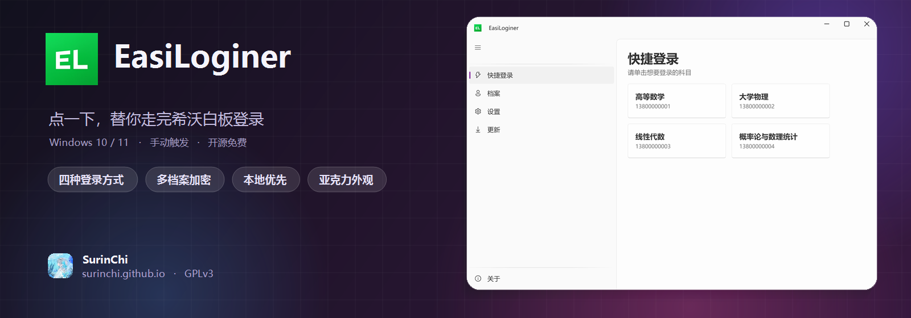
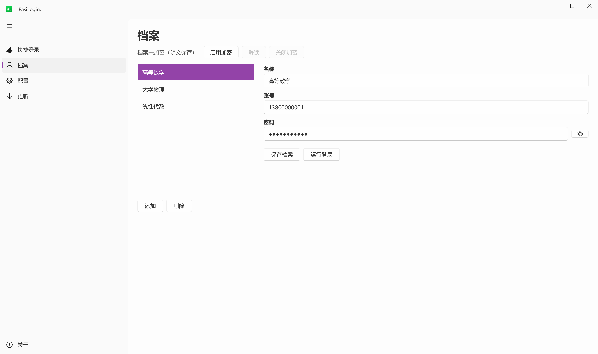
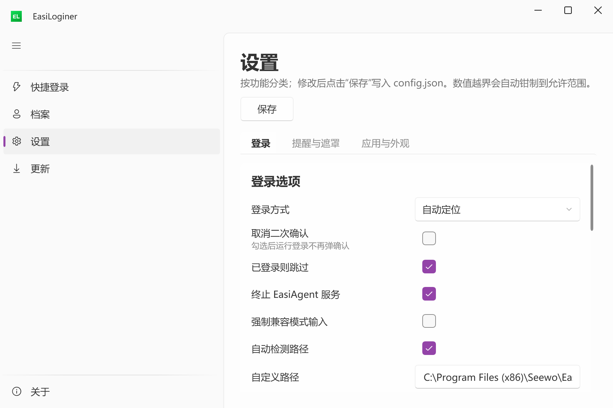
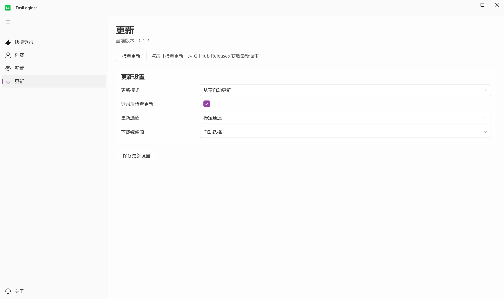

# EasiLoginer

[](https://github.com/SurinChi/Easiloginer/actions/workflows/ci.yml)




**SurinChi** · EasiLoginer 作者<br>
[官网 surinchi.github.io](https://surinchi.github.io) · [GitHub](https://github.com/SurinChi) · [问题反馈](https://github.com/SurinChi/Easiloginer/issues)

<br clear="left" />

一个**手动触发**的希沃白板自动登录工具：点一下按钮，它替你启动希沃、填好账号密码、点登录。

不驻留后台、不监视进程和文件、没有定时任务；除「检查更新」与拉取公告外不发起任何网络请求。

## 功能

- **四种登录方式**：自动定位（默认，最稳）、固定位置、图像识别、令牌投递
- **快捷登录页**：每个档案一张横向卡片，按科目点名登录；有档案时启动直接进这一页
- **档案管理**：多档案、备注、可选的**主密码加密**（账号密码以 `ea$` 密文落盘）
- **密码脱敏**：密码始终以圆点显示，点右侧眼睛可临时查看明文
- **流程可控**：超时、坐标缩放、隐私遮罩、警示横幅、状态浮窗、重试次数都可调；登录中可在状态浮窗点「立即终止」
- **设置存注册表**：全部设置写入 `HKCU\Software\EasiLoginer\Settings`，首次升级自动迁移旧 `config.json`
- **希沃集成**：检测安装路径、修补登录桥、终止 EasiAgent、查杀残留进程
- **更新检查**：从 GitHub Releases 检查、下载安装包并校验 SHA-256
- **公告页**：独立页面，入口在「关于」下方；启动时仍会提醒重要公告，发布新版本或维护通知无需重新发版
- **外观与背景**：亚克力毛玻璃效果，模糊强度与玻璃不透明度可调；背景支持桌面壁纸、本地图片、纯色和渐变
- **本地优先**：没有账号体系、不做遥测

## 安装与运行

### 安装包（推荐）

下载 `EasiLoginer-Setup-<版本>.exe`，双击后按向导安装：

- 欢迎 → 安装位置 → 附加任务（桌面快捷方式）→ 安装进度 → 完成并启动
- 默认安装到 `%LOCALAPPDATA%\Programs\EasiLoginer`，**不需要管理员权限**
- 选择已存在的目录时会提示「保留数据安装」：只替换程序文件，保留 `data\` 里的配置与档案
- 在「设置 → 应用 → 已安装的应用」里可正常卸载

静默安装：

```cmd
EasiLoginer-Setup-<版本>.exe /VERYSILENT /SUPPRESSMSGBOXES /NORESTART
```

### 绿色版

下载 `EasiLoginer_<版本>.zip`，解压到任意目录，双击 `EasiLoginer.exe` 即可。程序自包含 .NET 运行时，无需预装。

### 系统要求

- Windows 10 1809（x64）或更高版本
- 已安装希沃白板 5（用于登录）

## 使用说明

### 1. 首次启动

第一次运行会打开 6 步设置向导：用户协议 → 外观 → 登录方式 → 希沃白板 → 系统集成 → 完成。用户协议是完整版，需滚动到正文末尾后才能勾选「我同意」；未同意前「下一步」和「跳过向导」都不可用。设置项随时可以在「设置」页修改。

### 2. 添加档案

在「档案」页点「添加」，填写档案名与希沃账号密码，然后「保存档案」。密码允许先留空，登录前会提示补全。



多个账号可以建多条档案；给档案起一个科目名（如「高等数学」），快捷登录页就会按名字排序展示。

### 3. 日常登录

- **快捷登录页**：单击对应科目的按钮，直接走完整登录流程；
- **档案页**：选中档案后点「运行登录」；
- 两者都会先弹出运行前确认（可配置时长与推迟次数），确认后才启动希沃。

> 如果在配置里勾选了「取消二次确认」，点击按钮将直接执行，不再弹确认框。

### 4. 登录方式怎么选

| 方式 | 适用场景 |
|---|---|
| **自动定位**（默认） | 绝大多数情况首选，按控件定位，最稳定 |
| 固定位置 | 希沃界面没变但不支持自动定位时的兜底 |
| 图像识别 | 模板匹配，仅支持 1920×1080@100% 与 3840×2160@200% |
| 令牌投递 | 最快，但需要先修补希沃白板（见下方命令行 `patch --on`，可随时撤销） |

### 5. 主密码加密

在档案页点「启用加密」设置主密码后，账号与密码以 `ea$` 密文保存。

- 启用后密码不再以明文长期留在内存或界面上，登录时才临时解密；
- 密码框不再提供「显示密码」按钮；
- 查看档案、运行登录**不需要**再次输入主密码（本机缓存自动解锁）；
- **修改账号/密码、删除档案**时需要验证主密码，或该档案的原密码；
- 启用前若当前档案已有密码，会先要求验证该原密码；更换主密码需要旧主密码；
- 忘记主密码无法恢复，请自行备份或牢记。

### 6. 设置页



顶部按功能分成「登录」「提醒与遮罩」「应用与外观」三栏，改完点「保存」即可。未保存时左下角会出现提示和快捷保存按钮；顶部提供「重置全部」，每个分页底部提供「重置本页」。

常用项：

- **启动页面**：自动（有档案进快捷登录）/ 快捷登录 / 档案 / 设置
- **取消二次确认**：勾选后运行登录不再弹确认框
- **隐私保护遮罩**：默认关闭；在智慧大屏上启用可能导致意料之外的显示问题
- **未启动清理（天）**：超过指定天数未启动会清空全部数据，`0` 关闭，最短 7 天
- **警示横幅 / 状态浮窗**：文字、颜色、字号、位置都可调
- **字体**：从系统已安装字体中下拉选择
- **外观与背景**：亚克力开关、模糊强度（0–60）、玻璃不透明度（20–100%）、背景来源（跟随主题 / 纯色 / 渐变 / 桌面壁纸 / 本地图片）；修改后点「保存」立即生效

### 7. 更新



「更新」页检查 GitHub Releases：

- **稳定通道**：只提供正式版；
- **测试通道**：在正式版与预发布中取版本最高者；
- 发现新版本后可直接下载（显示进度、校验 SHA-256），完成后点「静默安装并重启」，安装程序会结束当前进程并在安装完成后自动拉起新版本；
- **下载镜像源「自动选择」**：先直连 GitHub，连接失败后依次回退到 ghfast / ghproxy；大文件按“无数据停滞”判断超时，不再被 20 秒总超时误杀。

### 8. 卸载

「设置 → 应用 → EasiLoginer → 卸载」。卸载会删除整个安装目录，并清理注册表中的设置，**包括 `data\` 中的档案**；需要保留时请先备份。

## 数据与隐私

设置存放在当前用户的注册表，档案与日志在程序目录的 `data\` 下：

| 位置 | 说明 |
|---|---|
| `HKCU\Software\EasiLoginer\Settings` | 全部设置；每个设置项一个注册表值（如 `Login.Method`），首次使用会从旧 `config.json` 自动迁移 |
| `profile.json` | 档案（启用主密码后账号密码为密文） |
| `state.json` | 上次启动时间（用于「未启动清理」） |
| `logs/` | 本地日志，不上传 |
| `cache/`、`avatars/` | 运行缓存 |

- **没有任何遥测**：崩溃与诊断只写本地日志；
- 程序不会在后台联网：只有「检查更新」「下载更新」以及拉取一次应用内公告时才访问 GitHub；
- 公告只发一次 `GET`，不携带账号、设备或使用信息；自动检查最多每 6 小时一次，也可在「关于」下方的「公告」页手动查看；
- 想保留数据：复制 `data\` 即可；换机器时把它放回程序目录。

### 应用内公告（维护者）

公告文件固定为仓库里的 [`announcements/announcements.json`](announcements/announcements.json)：

- 修改并提交到 `main` 即完成投放，不需要重新打包；GitHub raw 通常 5 分钟内生效；
- 完整字段、时间窗口、版本区间、排序与条数规则见 [`announcements/README.md`](announcements/README.md)；
- 本地预览：把同样的 JSON 放到程序目录的 `announcements\announcements.json`，应用会优先读取它；
- 公告文件保持 `{"schema":1,"announcements":[]}` 就是「没有公告」。

## 命令行

| 命令 | 说明 |
|---|---|
| 无参数 / `settings` | 打开主界面 |
| `login -i <档案ID>` | 用指定档案登录 |
| `login -a <账号> -p <密码>` | 用账号密码登录（与 `-i` 互斥） |
| `login ... -m` | 跳过运行前确认弹窗 |
| `skip` | 开启「取消二次确认」后退出 |
| `oobe` | 重新进入首次设置向导 |
| `patch --on` / `patch --off` | 修补 / 撤销希沃登录桥（绕过单实例；需要写入安装目录的权限） |

退出码：`0` 成功、`1` 失败或参数非法、`20–29` 为 `patch` 专用码。

## 从源码构建

### 环境

- **.NET 10 SDK**：仓库 `global.json` 锁定 `10.0.402`（`rollForward: latestFeature`）
- SDK 若安装在用户目录（如 `%USERPROFILE%\.dotnet`），先加入 PATH：

```powershell
$env:PATH = "$env:USERPROFILE\.dotnet;$env:PATH"
```

### 构建与测试

```powershell
dotnet build EasiLoginer.sln -c Release
dotnet test  EasiLoginer.sln -c Release --no-build
```

`Directory.Build.props` 启用了 `TreatWarningsAsErrors`，零警告是硬要求。当前共 487 个测试。

### 打包发布

```cmd
build\publish.cmd
```

版本号只有一个来源：`Directory.Build.props` 的 `<Version>`，发布脚本会自动读给 dotnet、安装向导与发布材料使用。

版本约定：稳定版 `0.2.0`；测试版 `0.2.0-alpha.1`、`0.2.0-beta.1`，每次递增末尾序号。程序集和安装包的数字版本固定为 `0.2.0.0`（去掉测试后缀），标签使用完整版本号（如 `v0.2.0-alpha.1`）。测试版不会占用将来的稳定版号，正式版仍从 `v0.2.0` 开始。

打包机额外需要：

- **7-Zip**（生成 LZMA2 负载）
- **Inno Setup 6**（生成安装向导）

产物在仓库外的 `..\EasiLoginer-dist\`：

| 文件 | 说明 |
|---|---|
| `EasiLoginer_<版本>.zip` | 绿色版，自包含 win-x64 |
| `EasiLoginer-Setup-<版本>.exe` | 安装向导，内置同一份程序 |
| `RELEASE-<版本>.md` | 自动生成的发布说明草稿（可直接粘到 GitHub Release） |
| `SHA256SUMS-<版本>.txt` | 两个产物的 SHA-256 校验和 |

完整的发版步骤、验证命令与常见问题见 [构建与发布流程](build/RELEASE.md)。

## 项目结构

| 目录 | 说明 |
|---|---|
| `src/EasiLoginer.Domain` | 纯领域模型：配置、档案、版本、坐标，不依赖任何平台代码 |
| `src/EasiLoginer.Application` | 登录流程编排、更新检查、抽象接口 |
| `src/EasiLoginer.Infrastructure` | 配置/档案存储、IPC、更新下载、Windows 适配 |
| `src/EasiLoginer.Integrations.EasiNote` | 希沃安装检测、修补、进程控制 |
| `src/EasiLoginer.Automation` | 四种登录策略与图像匹配（程序集名 `EasiLoginer.AutomationKit`） |
| `src/EasiLoginer.Presentation` | WPF + WPF-UI 界面：快捷登录、档案、设置、更新、关于、公告 |
| `src/EasiLoginer.Host` | 进程入口、命令行、单实例、日志 |
| `src/EasiLoginer.Patcher` | 独立的白板修补器（随包分发） |
| `tests/` | 6 个测试项目：领域、应用、基础设施、集成、界面、分层规则 |
| `announcements/` | 应用内公告：格式说明与对外发布的 `announcements.json` |
| `docs/screenshots/` | README 使用的界面截图 |

架构约束由 `tests/EasiLoginer.Architecture.Tests` 以只读 PE 元数据强制（Domain 仅依赖 BCL、Application 不碰 UI/网络、实现层互不引用、任何层不反向依赖 Host）。

## 常见问题

**Windows 提示「已保护你的电脑」或直接拒绝运行？**
发布包未做代码签名。SmartScreen 可点「更多信息 → 仍要运行」；开启 **Smart App Control** 的机器可能直接拦截（`0x800711C7`），这属于系统策略，需要签名或临时关闭 SAC 才能解决。

**点击运行登录没有任何反应？**
确认希沃白板已安装，并在设置页检查「自定义路径」是否正确；日志在 `data\logs\`。

**登录方式选哪个？**
默认的自动定位最稳；若希沃界面更新后失效，可临时切到固定位置。

**图像识别为什么不可用？**
只支持 1920×1080@100% 与 3840×2160@200%，其他显示环境会直接提示不支持。

**令牌投递提示未修补？**
先退出希沃白板，再执行 `EasiLoginer.exe patch --on`（需要写入安装目录的权限，通常要管理员；退出码 `20` 成功、`21` 失败、`22` 未找到希沃）。撤销用 `patch --off`。

**升级后数据还在吗？**
在。选择已存在的目录时安装向导会提示「保留数据安装」，只替换程序文件，`data\` 保留；卸载才会删除整个目录。

**为什么启动后数据没了？**
检查「未启动清理（天）」设置：超过设定天数未启动会自动清空数据。

## 上游与许可

- 本项目与其配置、档案格式**双向兼容**，加密档案可交叉解密；
- 产品行为参考并重写了 [EasiAuto](https://github.com/hxabcd/EasiAuto)（作者 hxabcd）的实现，遵循 **GNU GPLv3**；
- 上游版权与来源声明保留在 [NOTICE](NOTICE)，第三方依赖见 [THIRD-PARTY-NOTICES.md](THIRD-PARTY-NOTICES.md)；
- 本项目不支持 ClassIsland，也不会读写其配置；
- 设计文档见 [EasiLoginer C# 重构框架](EasiLoginer-CSharp-重构框架.md)。

Copyright (C) 2026 SurinChi。完整许可文本见 [LICENSE](LICENSE)。

## 反馈

问题与建议请提交到 [Issues](https://github.com/SurinChi/Easiloginer/issues)。
