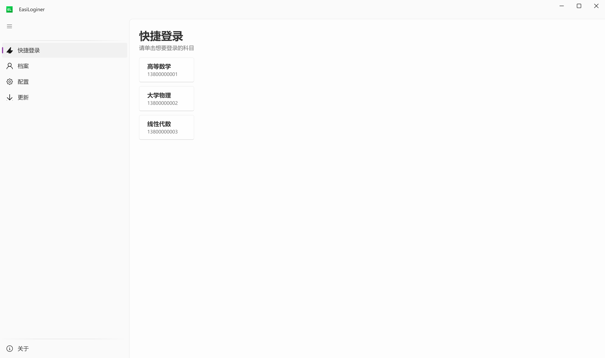
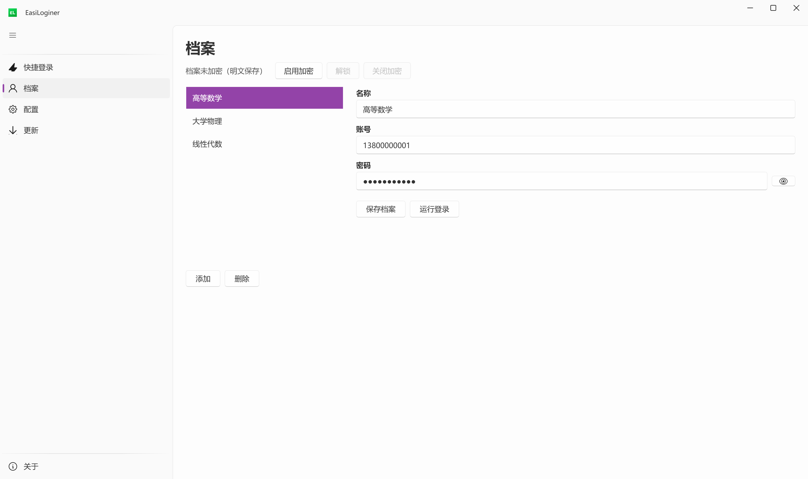
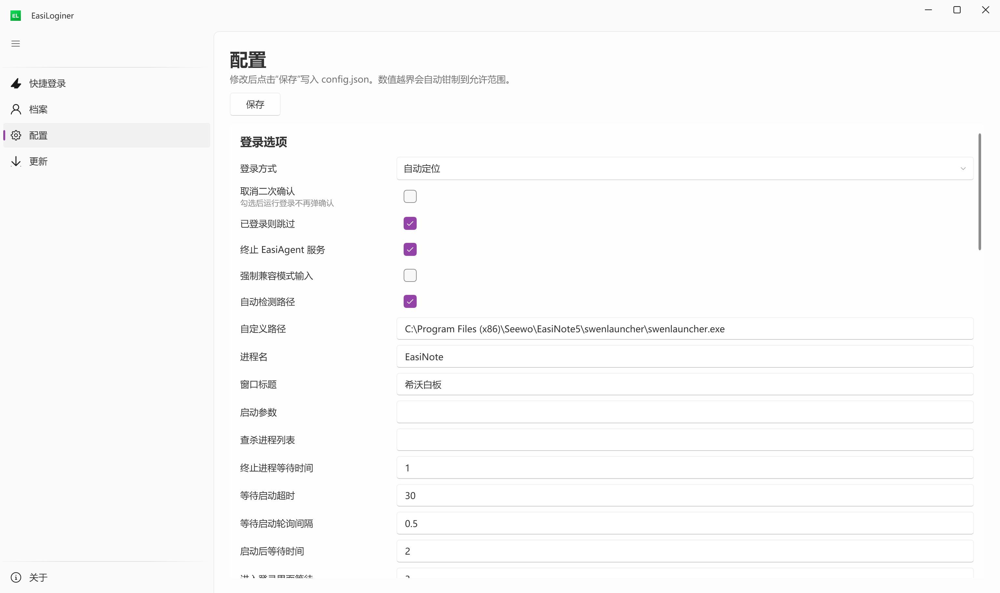
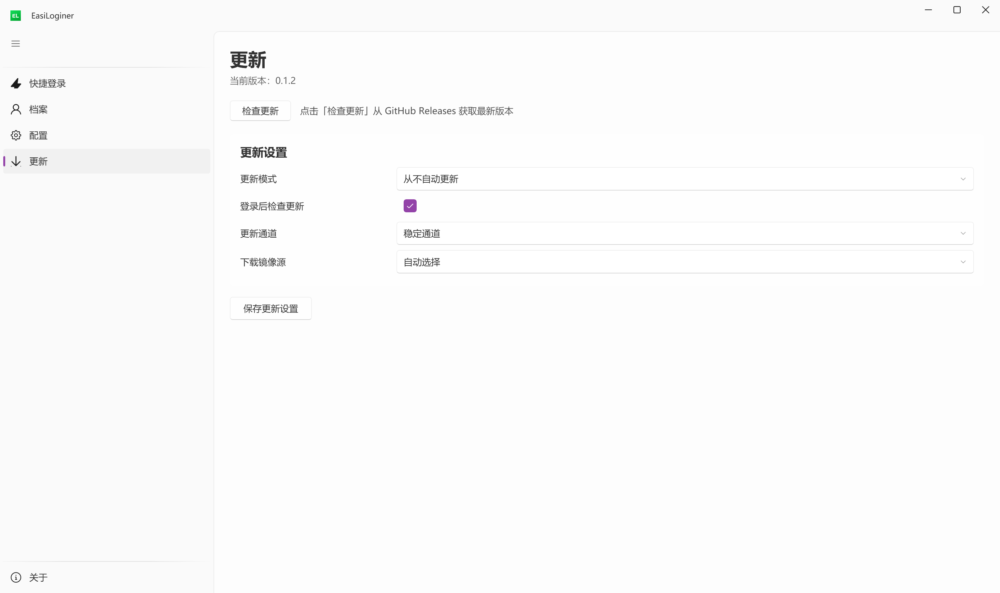

# EasiLoginer

[](https://github.com/SurinChi/Easiloginer/actions/workflows/ci.yml)

一个**手动触发**的希沃白板自动登录工具：点一下按钮，它替你启动希沃、填好账号密码、点登录。

不驻留后台、不监视进程和文件、没有定时任务；除「检查更新」外不发起任何网络请求。



## 功能

- **四种登录方式**：UI Automation（默认，最稳）、固定位置、图像识别、令牌投递
- **快捷登录页**：每个档案一个按钮，按科目点名登录；有档案时启动直接进这一页
- **档案管理**：多档案、备注、可选的**主密码加密**（账号密码以 `ea$` 密文落盘）
- **密码脱敏**：密码始终以圆点显示，点右侧眼睛可临时查看明文
- **流程可控**：超时、坐标缩放、隐私遮罩、警示横幅、状态浮窗、重试次数都可调
- **希沃集成**：检测安装路径、修补登录桥、终止 EasiAgent、查杀残留进程
- **更新检查**：从 GitHub Releases 检查、下载安装包并校验 SHA-256
- **本地优先**：没有账号体系、没有公告推送、不做遥测

## 安装与运行

### 安装包（推荐）

下载 `EasiLoginer-Setup-<版本>.exe`，双击后按向导安装：

- 欢迎 → 安装位置 → 附加任务（桌面快捷方式）→ 安装进度 → 完成并启动
- 默认安装到 `%LOCALAPPDATA%\Programs\EasiLoginer`，**不需要管理员权限**
- 升级安装只覆盖程序文件，保留 `data\` 里的配置与档案
- 在「设置 → 应用 → 已安装的应用」里可正常卸载

静默安装：

```cmd
EasiLoginer-Setup-0.1.2.exe /VERYSILENT /SUPPRESSMSGBOXES /NORESTART
```

### 绿色版

下载 `EasiLoginer_<版本>.zip`，解压到任意目录，双击 `EasiLoginer.exe` 即可。程序自包含 .NET 运行时，无需预装。

### 系统要求

- Windows 10 1809（x64）或更高版本
- 已安装希沃白板 5（用于登录）

## 使用说明

### 1. 首次启动

第一次运行会打开 6 步设置向导：用户协议 → 外观 → 登录方式 → 希沃白板 → 系统集成 → 完成。设置项随时可以在「配置」页修改。

### 2. 添加档案

在「档案」页点「添加」，填写档案名与希沃账号密码，然后「保存档案」。密码允许先留空，登录前会提示补全。



多个账号可以建多条档案；给档案起一个科目名（如「高等数学」），快捷登录页就会按名字排序展示。

### 3. 日常登录

- **快捷登录页**：单击对应科目的按钮，直接走完整登录流程；
- **档案页**：选中档案后点「运行登录」；
- 两者都会先弹出运行前确认（可配置时长与推迟次数），确认后才启动希沃。

> 如果在配置里勾选了「取消二次确认」，点击按钮将直接执行，不再弹确认框。

### 4. 登录方式怎么选

| 方式 | 适用场景 |
|---|---|
| **UI Automation**（默认） | 绝大多数情况首选，按控件定位，最稳定 |
| 固定位置 | 希沃界面没变但不支持 UI Automation 时的兜底 |
| 图像识别 | 模板匹配，仅支持 1920×1080@100% 与 3840×2160@200% |
| 令牌投递 | 最快，但需要先「修补希沃白板」（管理员权限，可撤销） |

### 5. 主密码加密

在档案页点「启用加密」设置主密码后，账号与密码以 `ea$` 密文保存。

- 查看档案、运行登录**不需要**主密码；
- **修改账号/密码、删除档案**时才要求验证；
- 忘记主密码无法恢复，请自行备份或牢记。

### 6. 配置页



常用项：

- **启动页面**：自动（有档案进快捷登录）/ 快捷登录 / 档案 / 配置
- **取消二次确认**：勾选后运行登录不再弹确认框
- **隐私保护遮罩**：默认关闭；在智慧大屏上启用可能导致意料之外的显示问题
- **未启动清理（天）**：超过指定天数未启动会清空全部数据，`0` 关闭，最短 7 天
- **警示横幅 / 状态浮窗**：文字、颜色、字号、位置都可调
- **字体**：从系统已安装字体中下拉选择

### 7. 更新



「更新」页检查 GitHub Releases：

- **稳定通道**：只提供正式版；
- **测试通道**：在正式版与预发布中取版本最高者；
- 发现新版本后可直接下载（显示进度、校验 SHA-256），完成后点「运行安装程序」。

### 8. 卸载

「设置 → 应用 → EasiLoginer → 卸载」。卸载会删除整个安装目录，**包括 `data\` 中的配置与档案**；需要保留时请先备份。

## 数据与隐私

所有数据都在程序目录的 `data\` 下：

| 文件 | 说明 |
|---|---|
| `config.json` | 全部设置，与上游 EasiAuto 格式兼容 |
| `profile.json` | 档案（启用主密码后账号密码为密文） |
| `state.json` | 上次启动时间（用于「未启动清理」） |
| `logs/` | 本地日志，不上传 |
| `cache/`、`avatars/` | 运行缓存 |

- **没有任何遥测**：崩溃与诊断只写本地日志；
- 程序不会在后台联网：只有你点「检查更新」或「下载更新」时才访问 GitHub；
- 想保留数据：复制 `data\` 即可；换机器时把它放回程序目录。

## 命令行

| 命令 | 说明 |
|---|---|
| 无参数 / `settings` | 打开主界面 |
| `login -i <档案ID>` | 用指定档案登录 |
| `login -a <账号> -p <密码>` | 用账号密码登录（与 `-i` 互斥） |
| `login ... -m` | 跳过运行前确认弹窗 |
| `skip` | 开启「取消二次确认」后退出 |
| `oobe` | 重新进入首次设置向导 |
| `patch --on` / `patch --off` | 修补 / 撤销希沃登录桥（绕过单实例） |

退出码：`0` 成功、`1` 失败或参数非法、`20–29` 为 `patch` 专用码。

## 从源码构建

### 环境

- **.NET 10 SDK**：仓库 `global.json` 锁定 `10.0.402`（`rollForward: latestFeature`）
- SDK 若安装在用户目录（如 `%USERPROFILE%\.dotnet`），先加入 PATH：

```powershell
$env:PATH = "$env:USERPROFILE\.dotnet;$env:PATH"
```

### 构建与测试

```powershell
dotnet build EasiLoginer.sln -c Release
dotnet test  EasiLoginer.sln -c Release --no-build
```

`Directory.Build.props` 启用了 `TreatWarningsAsErrors`，零警告是硬要求。当前共 402 个测试。

### 打包发布

```cmd
build\publish.cmd
```

打包机额外需要：

- **7-Zip**（生成 LZMA2 负载）
- **Inno Setup 6**（生成安装向导）

产物在仓库外的 `..\EasiLoginer-dist\`：

| 文件 | 说明 |
|---|---|
| `EasiLoginer_<版本>.zip` | 绿色版，自包含 win-x64 |
| `EasiLoginer-Setup-<版本>.exe` | 安装向导，内置同一份程序 |

## 项目结构

| 目录 | 说明 |
|---|---|
| `src/EasiLoginer.Domain` | 纯领域模型：配置、档案、版本、坐标，不依赖任何平台代码 |
| `src/EasiLoginer.Application` | 登录流程编排、更新检查、抽象接口 |
| `src/EasiLoginer.Infrastructure` | 配置/档案存储、IPC、更新下载、Windows 适配 |
| `src/EasiLoginer.Integrations.EasiNote` | 希沃安装检测、修补、进程控制 |
| `src/EasiLoginer.Automation` | 四种登录策略与图像匹配（程序集名 `EasiLoginer.AutomationKit`） |
| `src/EasiLoginer.Presentation` | WPF + WPF-UI 界面：快捷登录、档案、配置、更新、关于 |
| `src/EasiLoginer.Host` | 进程入口、命令行、单实例、日志 |
| `src/EasiLoginer.Patcher` | 独立的白板修补器（随包分发） |
| `tests/` | 6 个测试项目：领域、应用、基础设施、集成、界面、分层规则 |
| `docs/screenshots/` | README 使用的界面截图 |

架构约束由 `tests/EasiLoginer.Architecture.Tests` 以只读 PE 元数据强制（Domain 仅依赖 BCL、Application 不碰 UI/网络、实现层互不引用、任何层不反向依赖 Host）。

## 常见问题

**Windows 提示「已保护你的电脑」或直接拒绝运行？**
发布包未做代码签名。SmartScreen 可点「更多信息 → 仍要运行」；开启 **Smart App Control** 的机器可能直接拦截（`0x800711C7`），这属于系统策略，需要签名或临时关闭 SAC 才能解决。

**点击运行登录没有任何反应？**
确认希沃白板已安装，并在配置页检查「自定义路径」是否正确；日志在 `data\logs\`。

**登录方式选哪个？**
默认的 UI Automation 最稳；若希沃界面更新后失效，可临时切到固定位置。

**图像识别为什么不可用？**
只支持 1920×1080@100% 与 3840×2160@200%，其他显示环境会直接提示不支持。

**令牌投递提示缺少组件？**
需要先在配置页「修补希沃白板」（管理员权限），修补可随时撤销。

**升级后数据还在吗？**
在。覆盖安装只替换程序文件，`data\` 保留；卸载才会删除整个目录。

**为什么启动后数据没了？**
检查「未启动清理（天）」设置：超过设定天数未启动会自动清空数据。

## 上游与许可

- 本项目与其配置、档案格式**双向兼容**，加密档案可交叉解密；
- 产品行为参考并重写了 [EasiAuto](https://github.com/hxabcd/EasiAuto)（作者 hxabcd）的实现，遵循 **GNU GPLv3**；
- 上游版权与来源声明保留在 [NOTICE](NOTICE)，第三方依赖见 [THIRD-PARTY-NOTICES.md](THIRD-PARTY-NOTICES.md)；
- 本项目不支持 ClassIsland，也不会读写其配置；
- 设计文档见 [EasiLoginer C# 重构框架](EasiLoginer-CSharp-重构框架.md)。

Copyright (C) 2026 SurinChi。完整许可文本见 [LICENSE](LICENSE)。

## 反馈

问题与建议请提交到 [Issues](https://github.com/SurinChi/Easiloginer/issues)。
